# C4 — Уровень 3: Компоненты сервера 1С «ОТЕЛЬ»

> ⚠️ **Повторное извлечение №1 (2026-06-18, коммит «Изменения ПСН» c52a282):** архитектурная дельта — в [re-extraction/2026-06-18-ПСН/architecture-delta.md](re-extraction/2026-06-18-ПСН/architecture-delta.md). При расхождении смотри дельту.

> Агент: **Architect** (фаза «Интерпретация»). Внутренняя декомпозиция ключевого контейнера **«Сервер 1С:Предприятие»** (C2) на доменные модули, слой БПО и слой интеграций/обмена. Показаны общие модули-фасады.
> Источники: `inventory.md`, `dependencies.md`, `domain.md`, `code-analysis.md`, `permissions.md`, ADR 0006.
> Шкала доверия: 🟢 · 🟡 · 🔴.

---

## 1. Обзор слоёв

Сервер «ОТЕЛЬ» логически делится на три слоя:

1. **Доменный слой (12 модулей)** — гостиничная бизнес-логика; точки входа — `ObjectModule.bsl` документов и общие модули-фасады (`*Сервер`).
2. **Слой БПО ред. 3.2** — типовая инфраструктура фискального/торгового оборудования (`Subsystem.ПоддержкаОборудования`), используется доменом через тонкие обёртки.
3. **Слой интеграций и обмена** — диспетчеры, адаптеры протоколов, транспорт (COM/HTTP/FTP).

Сквозные фасады (`НастройкиСервер`, `ДокументыСервер`, `СлужебныеСервер`) обслуживают все слои.

## 2. Диаграмма компонентов (C4 L3)

```mermaid
flowchart TB
    classDef dom fill:#85bbf0,stroke:#5d82a8,color:#000;
    classDef bpo fill:#f0c285,stroke:#a8855d,color:#000;
    classDef intg fill:#b48ead,stroke:#7d6079,color:#fff;
    classDef facade fill:#a3be8c,stroke:#6f8259,color:#000;
    classDef db fill:#bbb,stroke:#777,color:#000;

    subgraph DOMAIN["Доменный слой (12 модулей)"]
        D1["Бронирование<br/>ЗаявкаСервер, ДокументыСервер,<br/>ЗаявкаНаБронирование"]:::dom
        D2["Размещение / Номерной фонд<br/>НомернойФонд, ОсмотрНомера,<br/>Интерфейс(шахматка)"]:::dom
        D3["Гости и регистрация<br/>КлиентыСервер, PassportBox*,<br/>ВыгрузкаДляФМС"]:::dom
        D4["Горничные<br/>ГорничныеЗарплата,<br/>ГорничныеОбслуживаниеНомераСервер"]:::dom
        D5["Минибар<br/>МинибарПриход/Расход,<br/>себестоимость FIFO"]:::dom
        D6["Доп.услуги / Коворкинг<br/>КоворкингСервер,<br/>СписаниеДопУслуг"]:::dom
        D7["Ценообразование<br/>КалендарьЦен, ТарифныеПланы,<br/>ДокументыСервер(цены)"]:::dom
        D8["Финансы и касса<br/>КассовыйДокумент, ГрупповойСчетСервер,<br/>ЗаявкаОбщееКлиентСервер"]:::dom
        D9["Аудит и отчётность<br/>ЕжедневныйАудит,<br/>ЕжедневныйОтчетФакт"]:::dom
        D10["Персонал и зарплата<br/>Администраторы,<br/>АдминистраторыЗарплата"]:::dom
    end

    subgraph BPO["Слой БПО ред. 3.2 (Subsystem.ПоддержкаОборудования)"]
        B1["Менеджер оборудования<br/>МенеджерОборудования*"]:::bpo
        B2["Чекопечатающие устройства / ККТ<br/>ФУ_Клиент, ОплатыЧекКлиент"]:::bpo
        B3["Платёжные системы (эквайринг)"]:::bpo
        B4["Маркировка + ФЛК (проверка КМ)"]:::bpo
        B5["Очереди/журналы операций<br/>(фискальные/платёжные/КМ)"]:::bpo
    end

    subgraph INTG["Слой интеграций и обмена (модуль 12)"]
        I1["ОбменГостиницы<br/>(план обмена XML+FTP)"]:::intg
        I2["ОбменСайт / HTTP_Модуль<br/>(заявки, заселения)"]:::intg
        I3["МесенджерСервер →<br/>WhatsAppСервер/TelegramСервер →<br/>GREEN_WhatsApp"]:::intg
        I4["PayKeeperСервер<br/>(эквайринг REST)"]:::intg
        I5["ОбменГорничныеСервер /<br/>ОбменКартинкаСервер (COM)"]:::intg
        I6["ОбменВыписка /<br/>ОбменБухгалтерияНДС (FTP)"]:::intg
    end

    subgraph FACADE["Сквозные фасады"]
        F1["НастройкиСервер<br/>профиль отеля, RBAC (Админ),<br/>Это*() мульти-отель"]:::facade
        F2["ДокументыСервер<br/>занятость, цены, скидки, проверки"]:::facade
        F3["СлужебныеСервер<br/>утилиты, COM-коннекты"]:::facade
    end

    DBREG[("Регистры/таблицы СУБД<br/>ЗанятостьНомеров, Взаиморасчеты,<br/>Минибар*, УборкиНомеров, ...")]:::db

    %% Зависимости домена
    D1 --> F2
    D1 --> D2
    D1 --> D7
    D1 --> D8
    D1 --> D3
    D7 --> F2
    D8 --> B2
    D5 --> D4
    D5 --> D6
    D9 --> D1
    D2 --> I5
    D4 --> I5

    %% Фасады
    D1 --> F1
    D8 --> F1
    F2 --> F1

    %% БПО
    D8 --> B1
    B1 --> B2
    B2 --> B5
    B3 --> B5

    %% Интеграции
    D1 --> I2
    D3 --> I3
    D8 --> I4
    I1 --> F3
    I5 --> F3

    %% Хранение
    D1 --> DBREG
    D5 --> DBREG
    D8 --> DBREG
    D4 --> DBREG
```

## 3. Компоненты доменного слоя

| Модуль | Ключевые общие модули / объекты | Зона ответственности | Сложность |
|--------|--------------------------------|----------------------|-----------|
| Бронирование | `ЗаявкаСервер`, `ДокументыСервер`, `Document.ЗаявкаНаБронирование`, `ЗаявкаСайт` | Жизненный цикл брони, почасовая занятость, разделение счёта, конвертация заявок с сайта | high |
| Размещение / Номерной фонд | `Catalog.НомернойФонд`, `DataProcessor.Интерфейс` (шахматка), `ОсмотрНомера`, загрузчики номеров | Номерной фонд, шахматка, осмотр, импорт номеров по COM | high |
| Гости и регистрация | `КлиентыСервер`, `PassportBoxВызовСервера`, `ВыгрузкаДляФМС`, `КлиентыОбъединиение` | Карточка гостя, антидубль, ФМС, OCR паспортов, дедупликация | high |
| Горничные | `ГорничныеЗарплата`, `ГорничныеОбслуживаниеНомераСервер`, `ОбменГорничныеСервер` | Уборки, сдельная ЗП, прачечная, синхронизация с базой планшетов | high |
| Минибар | `МинибарПриход/Расход`, `DataProcessor.Минибар` | FIFO-партии, средневзвешенная себестоимость, зеркало в `ДопУслуги` | medium |
| Доп. услуги / Коворкинг | `КоворкингСервер`, `СписаниеДопУслуг`, `Catalog.ДопУслуги` | Прайс услуг, почасовой коворкинг, цепочки счетов, списание долгов | high |
| Ценообразование | `КалендарьЦен`, `ДокументыСервер` (цены), `ТарифныеПланы`, `БазовыеЦены` | Каскад цены дня, тарифы, скидки, цены конкурентов | high |
| Финансы и касса | `КассовыйДокумент`, `ГрупповойСчетСервер`, `ЗаявкаОбщееКлиентСервер` | Оплаты, FIFO-гашение долга, групповые счета, закрытие периода, кассовая смена | high |
| Аудит и отчётность | `Document.ЕжедневныйАудит`, `DataProcessor.ЕжедневныйОтчетФакт(Сводный)` | Ночной аудит, ADR/загрузка, управленческие витрины | high |
| Персонал и зарплата | `Catalog.Администраторы`, `Document.АдминистраторыЗарплата` | Кадры ресепшн, сдельный расчёт ЗП по сменам | medium |

> Модули «Подключаемое оборудование (БПО)» и «Интеграции и обмен» вынесены в отдельные слои на диаграмме (BPO / INTG) — это 11-й и 12-й модули из 12.

## 4. Сквозные фасады

| Фасад | Назначение | Доверие |
|-------|-----------|---------|
| `НастройкиСервер` | Профиль текущего отеля (`Это*()`), доменный RBAC (`ЭтоАдмин/ЭтоАдминистратор`), функциональные опции мульти-отеля | 🟢 |
| `ДокументыСервер` | Проверка/запись занятости, расчёт цен/скидок/комиссий, проверка заполнения заявки | 🟢 |
| `СлужебныеСервер` | Утилиты, COM-коннекты (вкл. `ConnectБаза_BONUS` — мёртвый код) | 🟢 |

## 🔴 ПРОБЕЛЫ компонентов

- 🔴 Граница «домен ↔ типовая БПО» проведена по подсистеме `ПоддержкаОборудования`; внутренняя декомпозиция БПО не разбиралась (осознанная граница анализа, ADR 0006).
- 🟡 Часть зависимостей между доменными модулями выведена из `dependencies` в `modules.json`, а не из явных вызовов.
