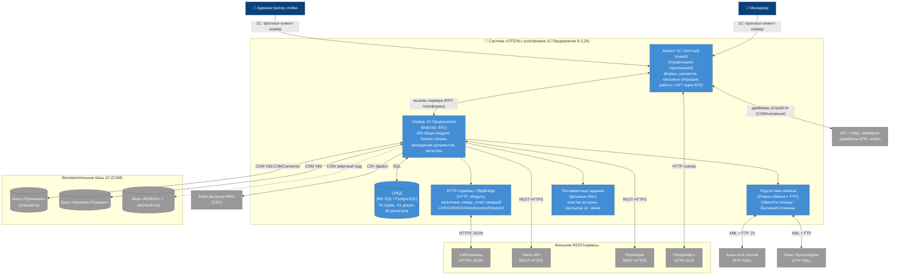

# C4 — Уровень 2: Контейнеры системы «ОТЕЛЬ»

> ⚠️ **Повторное извлечение №2 (2026-08-21-ПСН-РЕНОМЕ, собственная ветка ПСН «Реноме»):** архитектурная дельта — в [re-extraction/2026-08-21-ПСН-РЕНОМЕ/architecture-delta.md](re-extraction/2026-08-21-ПСН-РЕНОМЕ/architecture-delta.md), разд. 2 и 9. Топология контейнеров НЕ меняется; адресная правка одна — :100 (хардкод строки MS SQL «присутствует в отключённой функции»: функции в ПСН нет). **Приоритет:** эта дельта старше дельты №1 (2026-06-18) и канона.

> Агент: **Architect** (фаза «Интерпретация»). Декомпозиция системы «ОТЕЛЬ» на исполняемые/развёртываемые единицы (контейнеры) с технологиями и протоколами.
> Источники: `inventory.md`, `dependencies.md`, `domain.md`, `flowcharts/Интеграции.md`, ADR 0005/0006/0009.
> Замечание о платформе: 1С:Предприятие — не контейнерная архитектура; «контейнеры» C4 здесь = логические/процессные единицы платформенного развёртывания (см. `deployment.md`).
> Шкала доверия: 🟢 · 🟡 · 🔴.

---

## 1. Диаграмма контейнеров (C4 L2)

## 2. Контейнеры и технологии

| # | Контейнер | Технология | Ответственность | Доверие |
|---|-----------|-----------|-----------------|---------|
| C1 | **Клиент 1С (толстый/тонкий)** | Управляемое приложение 1С (`defaultRunMode=ManagedApplication`); толстый клиент тоже доступен (`АдминистраторСистемы.ThickClient`) | UI: формы документов, шахматка размещения/коворкинга, кассовые операции, печать и фискализация чеков через драйверы БПО, сканер PassportBox | 🟢 |
| C2 | **Сервер 1С:Предприятие** | Кластер 1С 8.3.24 (расширения 8.3.27), BSL; 183 общих модуля | Вся бизнес-логика: проведение документов, расчёт цен/долгов/занятости, движения 60 регистров, фасады (`ДокументыСервер`, `ЗаявкаСервер`, `НастройкиСервер` и др.) | 🟢 |
| C3 | **СУБД** | MS SQL Server или PostgreSQL (физ. схема генерируется платформой; `dataLockControlMode=Managed`) | Хранение: 74 справочника, 41 документ, 53 РС, 7 РН, константы | 🟢 (СУБД-движок 🟡) |
| C4 | **HTTP-сервисы / HttpBridge** | Подсистема `HttpBridge`, `HTTP_Модуль`, `HTTPСоединение`/`HTTPЗапрос` | Приём заявок с сайта (JSON), межбазовый HTTP для заселений и сводного ежедневного отчёта по сети | 🟢 |
| C5 | **Подсистема обмена (планы обмена + FTP)** | Планы обмена 1С (`ОбменГостиницы`, `ВГ_ВыпискаГостиницы`, `ОбменТест`), XDTO, `FTPСоединение` :21 пассивный | Асинхронный межотельный обмен (XML→FTP), загрузка банковских выписок, выгрузка в Бухгалтерию/НДС | 🟢 |
| C6 | **Регламентные задания** | Фоновые задания 1С (6 шт., из инфраструктуры БПО) | Очистка истории операций (чеки/КМ/оборудование/платежи/фискализация), рассылка электронных чеков | 🟢 |
| EXT-COM | **Внешние базы 1С (COM)** | Отдельные ИБ 1С, `V83.COMConnector` (синхронный RPC), кэш соединения в параметре сеанса | Горничные (планшеты), Картинки планшета, BONUS (🔴 мёртвый код) | 🟢 |
| EXT-REST | **Внешние REST-сервисы** | HTTPS REST | Green API, PayKeeper, PassportBox, сайт/каналы | 🟢 |
| EXT-HW | **Фискальное/торговое оборудование** | БПО ред. 3.2, драйверы `.addin` (67 шт.), `ДрайверыОборудования`, `АТОЛ10106` | ККТ, эквайринг, маркировка, ОФД, датчики | 🟢 |

## 3. Протоколы взаимодействия (сводка)

| Источник → приёмник | Протокол | Формат | Синхронность |
|---------------------|----------|--------|--------------|
| Клиент ↔ Сервер 1С | Протокол платформы 1С | внутренний | синхронный RPC |
| Сервер ↔ СУБД | SQL (нативный драйвер платформы) | реляционный | синхронный |
| HTTP-сервисы ↔ Сайт | HTTPS | JSON | синхронный GET |
| Сервер → Green API | HTTPS | JSON (REST) | синхронный, идемпотентность через РС `РассылкаWhatsApp` |
| Сервер ↔ PayKeeper | HTTPS | JSON, Basic+token (TTL 1200с) | синхронный, polling статусов |
| Клиент ↔ PassportBox | HTTP | JSON (page3/OCR/MRZ) | синхронный |
| Обмен ↔ отели/банк | FTP :21 пассивный | XML (сообщения плана обмена) | асинхронный |
| Сервер ↔ внешние базы 1С | COM `V83.COMConnector` | вызовы фасадных модулей | синхронный RPC, до 3 попыток |
| Сервер → ФМС | файл | CSV `#v.2.0.0` | пакетный (выгрузка) |

## 🔴 ПРОБЕЛЫ контейнеров

- 🔴 Конкретный движок СУБД (MS SQL vs PostgreSQL) не зафиксирован в исходниках (хардкод строки MS SQL присутствует в отключённой функции — см. `architecture.md` §техдолг).
- 🔴 Точная топология HttpBridge (входящие HTTP-сервисы публикуются ли наружу или используются только для межбазового обмена внутри сети) — выведено.
- 🟡 BONUS-база подключается из мёртвого кода проведения оплат — фактически контур не активен.
