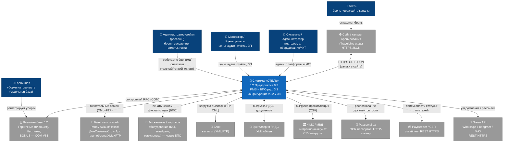

# C4 — Уровень 1: Контекст системы «ОТЕЛЬ»

> Агент: **Architect** (фаза «Интерпретация»). Система 1С:Предприятие 8 «ОТЕЛЬ» (BSL, 1C:EDT), версия конфигурации 3.2.7.38, на базе типовой «Библиотеки подключаемого оборудования» (БПО) ред. 3.2.
> Источники: `inventory.md`, `dependencies.md`, `domain.md`, `permissions.md`, `flowcharts/Интеграции.md`, ADR 0005/0006/0008/0009.
> Шкала доверия: 🟢 ПОДТВЕРЖДЕНО · 🟡 ВЫВЕДЕНО · 🔴 ПРОБЕЛ.

---

## 1. Назначение системы

«ОТЕЛЬ» — это PMS (Property Management System) для управления гостиницей/сетью отелей: бронирование, размещение, регистрация гостей (вкл. миграционный учёт ФМС), горничные, минибар, доп. услуги/коворкинг, ценообразование, касса/финансы, фискализация через БПО, ночной аудит, расчёт зарплаты персонала и обмен данными между базами сети и внешними сервисами.

## 2. Диаграмма контекста (C4 L1)

## 3. Персоны (акторы)

| Персона | Роль | Механизм доступа | Доверие |
|---------|------|------------------|---------|
| **Администратор стойки (ресепшн)** | Ведёт брони, заселение/выезд, оплаты, карточки гостей | Клиент 1С; `Пользователи.Админ=Ложь`, роль `ПолныеПрава` | 🟢 (механизм), 🟡 (точная роль оператора) |
| **Горничная** | Регистрирует уборки/обслуживание номеров | Планшет → **отдельная база 1С «Горничные»** (COM-обмен с «ОТЕЛЬ») | 🟢 |
| **Менеджер / Руководитель** | Цены, тарифы, ночной аудит, управленческие отчёты (ADR, загрузка), расчёт ЗП | Клиент 1С; `Пользователи.Админ=Истина` (расширенные права в коде) | 🟢 |
| **Системный администратор** | Администрирование платформы, настройка оборудования/ККТ | Роли `АдминистраторСистемы` / `ПолныеПрава` | 🟢 |
| **Гость (через сайт)** | Оставляет заявку на бронирование на сайте/канале | Внешний — взаимодействует с сайтом, не с «ОТЕЛЬ» напрямую | 🟢 |

## 4. Внешние системы и протоколы

| Внешняя система | Направление | Протокол / формат | Точка в коде | Доверие |
|-----------------|-------------|-------------------|--------------|---------|
| Сайт / каналы бронирования (TravelLine и др.) | ⬇ приём заявок | HTTPS GET → JSON | `ОбменСайт`, `HTTP_Модуль`, `Document.ЗаявкаСайт` | 🟢 |
| Green API (WhatsApp/Telegram/MAX) | ⬆ уведомления/рассылки | REST HTTPS (`api.green-api.com`) | `GREEN_WhatsApp`, `WhatsAppСервер`, `TelegramСервер`, `МесенджерСервер` | 🟢 |
| PayKeeper / СБП | ⬍ оплаты и статусы | REST HTTPS:443, token-сессия | `PayKeeperСервер`, `PayKeeperКлиентСервер` | 🟢 |
| PassportBox | ⬍ OCR паспортов | HTTP-сканер, JSON | `PassportBoxВызовСервера` | 🟢 |
| ФМС / МВД | ⬆ миграционный учёт | Текстовый CSV `#v.2.0.0` (`;`) | `DataProcessor.ВыгрузкаДляФМС` | 🟢 |
| Бухгалтерия / НДС | ⬍ обмен документами | XML (план обмена) | `ОбменБухгалтерияНДС`, `ВыгрузкаНДС` | 🟢 |
| Банк | ⬇ выписки | XML + FTP, план обмена `ВГ_ВыпискаГостиницы` | `ОбменВыписка`, `Document.ВыпискаБанка` | 🟢 |
| Фискальное/торговое оборудование | ⬍ печать чеков, фискализация | БПО ред. 3.2 (драйверы `.addin`, ОФД, ККТ) | `ОборудованиеЧекопечатающиеУстройстваКлиент`, `ФУ_Клиент` | 🟢 |
| Базы сети отелей | ⬍ межотельный обмен | XML + FTP (порт 21, пассивный) | `ОбменГостиницы`, `ExchangePlan.ОбменГостиницы` | 🟢 |
| Внешние базы 1С (Горничные/Картинки/BONUS) | ⬍ синхронный RPC | COM `V83.COMConnector` | `ОбменГорничныеСервер`, `ОбменКартинкаСервер` | 🟢 |

## 🔴 ПРОБЕЛЫ контекста

- 🔴 Точная роль платформы, под которой работает рядовой оператор стойки, не подтверждена настройками ИБ (доменная роль `Администратор` пуста; вероятно `ПолныеПрава` + `Админ=Ложь`).
- 🔴 Точный перечень и состав внешних баз 1С по COM (BONUS — в мёртвом коде) и каналов сайта (помимо TravelLine) — частично выведен.
