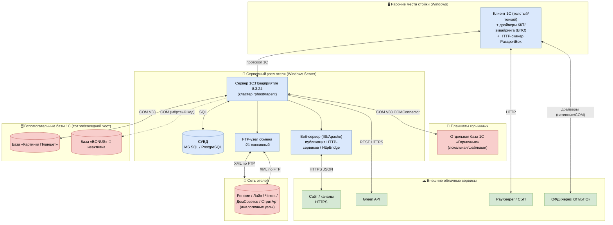

# Топология развёртывания — ОТЕЛЬ

> ⚠️ **Повторное извлечение №2 (2026-08-21-ПСН-РЕНОМЕ, собственная ветка ПСН «Реноме»):** архитектурная дельта — в [re-extraction/2026-08-21-ПСН-РЕНОМЕ/architecture-delta.md](re-extraction/2026-08-21-ПСН-РЕНОМЕ/architecture-delta.md), разд. 9. Топология развёртывания НЕ меняется; адресная правка одна — :90 (снять «строка MS SQL в коде»; COM-пути и Pwd="123" остаются). **Приоритет:** эта дельта старше дельты №1 (2026-06-18) и канона.

> Агент: **Architect** (фаза «Интерпретация», уровень `detalhado`). Топология развёртывания системы 1С «ОТЕЛЬ».
> ⚠ Классических контейнеров НЕТ: Docker/docker-compose/облачные конфиги в исходниках не обнаружены (`inventory.md` §8, `surface.json: docker={}`, `ci_cd=[]`). Развёртывание — **платформенное** (1С:Предприятие + СУБД), описано ниже.
> Источники: `inventory.md`, `dependencies.md`, `domain.md`, ADR 0005/0009.
> Шкала доверия: 🟢 · 🟡 · 🔴.

---

## 1. Диаграмма развёртывания

## 2. Узлы развёртывания

| Узел | ПО / технология | Размещение | Доверие |
|------|-----------------|------------|---------|
| **Рабочее место стойки** | Клиент 1С (управляемое приложение; доступен и толстый клиент) + драйверы оборудования БПО + сканер PassportBox | Windows ПК у стойки | 🟢 |
| **Планшет горничной** | Отдельная база 1С «Горничные» | планшет/локальная ИБ | 🟢 |
| **Сервер 1С:Предприятие** | Кластер 1С 8.3.24 (расширения 8.3.27), BSL-логика | Windows Server отеля | 🟢 (ОС 🟡) |
| **СУБД** | MS SQL Server или PostgreSQL | тот же/соседний сервер | 🟡 (движок не зафиксирован) |
| **Веб-сервер** | IIS/Apache — публикация HTTP-сервисов / HttpBridge | серверный узел | 🟡 |
| **FTP-узел обмена** | FTP-сервер (порт 21, пассивный режим) | узел сети | 🟢 |
| **Внешние базы 1С** | ИБ «Картинки Планшет», «BONUS» — через COM | локальные пути (`C:\_Base1C\...`) | 🟢 |
| **Узлы сети отелей** | Аналогичные инсталляции «ОТЕЛЬ» | по отелям | 🟢 |
| **Облачные сервисы** | Сайт/каналы, Green API, PayKeeper, ОФД | публичный интернет (HTTPS) | 🟢 |

## 3. Особенности развёртывания

- **Платформенное развёртывание, не контейнерное.** 🟢 Нет Dockerfile/compose/k8s/облачных манифестов; физическая схема БД генерируется платформой из метаданных.
- **Windows-привязка.** 🟡 COM `V83.COMConnector` и драйверы БПО требуют Windows; обмен с горничными/картинками жёстко привязан к файловым путям (ADR 0005).
- **Сетевой обмен.** 🟢 Межотельный обмен — асинхронный XML+FTP (план обмена `ОбменГостиницы`); банковские выписки — `ВГ_ВыпискаГостиницы`.
- **Фоновые процессы.** 🟢 6 регламентных заданий (очистка истории операций, рассылка эл. чеков) исполняются на сервере 1С.
- **Мультиотельность.** 🟡 Профиль конкретного отеля определяется в коде (`НастройкиСервер.Это*()`), а не отдельной конфигурацией развёртывания (ADR 0008).

## 🔴 ПРОБЕЛЫ топологии

- 🔴 Конкретный движок СУБД, версия ОС сервера, способ публикации веб-сервера — в исходниках не зафиксированы (требуют подтверждения у эксплуатации).
- 🔴 Реальная сетевая сегментация (DMZ для FTP/веб, VPN между отелями) — неизвестна.
- 🔴 Захардкоженные пути/учётные данные COM и строка MS SQL в коде (см. `architecture.md` §техдолг) указывают на ручную, не автоматизированную конфигурацию развёртывания.
