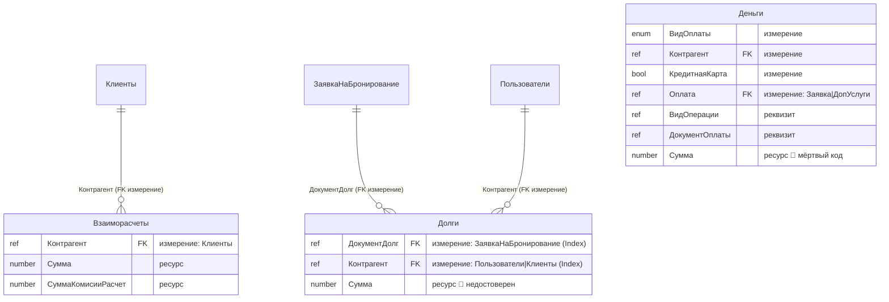
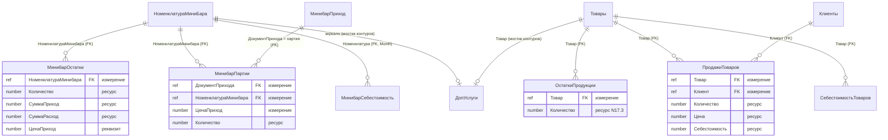
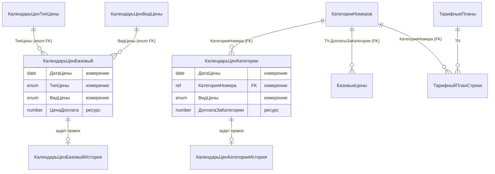

# Расширенный ERD учётного ядра — ОТЕЛЬ (Data Master)

> Агент: **Data Master**. Дополняет `erd-complete.md` Архитектора (ERD домена по 8 блокам), фокусируясь на **учётном ядре**: регистры накопления + регистры сведений и их связи с документами-регистраторами и справочниками-измерениями. НЕ перезаписывает `erd-complete.md`.
> Источник: `.mdo` (`registerRecords`, измерения/ресурсы прочитаны напрямую), `database.md`.
> Соглашения 1С: регистр = таблица движений; **измерения = FK** (ключ); ресурсы — без пометки; документ-регистратор пишет движения регистра (связь «1 документ : N движений»).
> Шкала доверия: 🟢 из `.mdo` · 🟡 выведено · 🔴 недостоверно/мёртвый код.

---

## 1. Документы-регистраторы → регистры (карта движений) 🟢

```mermaid
erDiagram
    ЗаявкаНаБронирование ||--o{ Долги : "AR (приход долга) 🔴"
    ЗаявкаНаБронирование ||--o{ Взаиморасчеты : "AR"
    ЗаявкаНаБронирование ||--o{ ОстаткиПродукции : "AR"
    ЗаявкаНаБронирование ||--o{ ПродажиТоваров : "AR 🟡"
    ЗаявкаНаБронирование ||--o{ ЗанятостьНомеров : "IR (часы)"

    КассовыйДокумент ||--o{ Долги : "AR 🔴"
    КассовыйДокумент ||--o{ Взаиморасчеты : "AR (живой)"
    КассовыйДокумент ||--o{ Деньги : "AR 🔴 мёртвый"
    ВыпискаБанка ||--o{ Долги : "AR 🔴"
    ВыпискаБанка ||--o{ Взаиморасчеты : "AR"
    ВыпискаБанка ||--o{ Деньги : "AR 🔴"
    ПрочиеОплаты ||--o{ Долги : "AR 🔴"
    ПрочиеОплаты ||--o{ Взаиморасчеты : "AR"
    ПрочиеОплаты ||--o{ Деньги : "AR 🔴"
    ВзаиморасчетыКоректировка ||--o{ Взаиморасчеты : "AR (ручная)"
    ГашениеДолгов_Старая ||--o{ Долги : "AR 🔴 устар."

    МинибарПриход ||--o{ МинибарОстатки : "AR (+)"
    МинибарПриход ||--o{ МинибарПартии : "AR (партия)"
    МинибарРасход ||--o{ МинибарОстатки : "AR (-)"
    МинибарРасход ||--o{ МинибарПартии : "AR (FIFO)"
    ИнвентарицацияБара ||--o{ ОстаткиПродукции : "AR (±)"
    Инвентарицация ||--o{ ОстаткиПродукции : "AR (±)"
    ПоступлениеТоваров ||--o{ ОстаткиПродукции : "AR (+)"
    ПоступлениеТоваров ||--o{ СебестоимостьТоваров : "IR"
    ПоступлениеТоваровБара ||--o{ ОстаткиПродукции : "AR (+)"
    ПоступлениеТоваровБара ||--o{ СебестоимостьТоваров : "IR"

    ОсмотрНомера ||--o{ ЗамечанияПоНомерам : "IR"
    ГорничныеОбслуживаниеНомера ||--o{ УборкиНомеров : "IR"
    ЕжедневныйАудит ||--o{ ПроданныеНомера : "IR"
    КоворкингЗаявка ||--o{ ЗанятостьНомеровКоворкинг : "IR"
    КоворкингСчета ||--o{ ЗанятостьНомеровКоворкинг : "IR"
```

---

## 2. Денежный контур (регистры накопления + измерения-FK) 🟢/🔴

> **Достоверный путь оплат:** `КассовыйДокумент`/`ВыпискаБанка`/`ПрочиеОплаты` → `Взаиморасчеты` (Balance) + ТЧ заявки `СчетаДетальноДолги`/`РаспределениеОплатДолги`. Регистры `Долги` и `Деньги` — формальные регистраторы, для отчётности недостоверны (ADR 0001).
> **Все три — `Balance` (Остатки)**, не Turnovers (`<registerType>` отсутствует в `.mdo`).

---

## 3. Товарный контур (два изолированных учёта) 🟢

> 🔴 Контуры «Минибар» и «Бар»/«Товары» не связаны движениями. Единственный мостик — реквизиты `ДопУслуги.НоменклатураМинибара` и `ДопУслуги.Товар` (продажа гостю идёт через `ДопУслуги`/чек, а не через `ПродажиТоваров`).

---

## 4. Контур доступности и операционного учёта (регистры сведений) 🟢

```mermaid
erDiagram
    НомернойФонд ||--o{ ЗанятостьНомеров : "Номер (FK измерение)"
    Клиенты ||--o{ ЗанятостьНомеров : "Клиент (FK измерение)"
    ЗаявкаНаБронирование ||--o{ ЗанятостьНомеров : "регистратор"
    ЗанятостьНомеров {
        ref Номер FK "измерение"
        ref Клиент FK "измерение"
        date ПериодРезерва "измерение (час)"
        number Номер_пп "измерение"
        bool Зарезервирован "ресурс"
        bool БонШанс "ресурс"
    }

    КоворкингНомера ||--o{ ЗанятостьНомеровКоворкинг : "КоворкингНомер (FK)"
    КоворкингЗаявка ||--o{ ЗанятостьНомеровКоворкинг : "регистратор"
    КоворкингСчета ||--o{ ЗанятостьНомеровКоворкинг : "регистратор"
    ЗанятостьНомеровКоворкинг {
        ref КоворкингНомер FK "измерение"
        date ПериодРезерва "измерение"
        ref ДокументРегистратор FK "измерение"
        bool Зарезервирован "ресурс"
        ref Клиент "ресурс (нетипично)"
    }

    ГорничныеОбслуживаниеНомера ||--o{ УборкиНомеров : "Документ (регистратор)"
    НомернойФонд ||--o{ УборкиНомеров : "Комната"
    Горничные ||--o{ УборкиНомеров : "Горничная"

    ОсмотрНомера ||--o{ ЗамечанияПоНомерам : "регистратор"
    НомернойФонд ||--o{ ЗамечанияПоНомерам : "Комната (FK)"
    Замечания ||--o{ ЗамечанияПоНомерам : "Замечание (FK)"

    ЕжедневныйАудит ||--o{ ПроданныеНомера : "регистратор"
    НомернойФонд ||--o{ ПроданныеНомера : "НомерВРезерв (FK)"
    ЗаявкаНаБронирование ||--o{ ПроданныеНомера : "Бронь (FK)"
```

---

## 5. Контур ценообразования (независимые регистры сведений) 🟢

> Legacy-регистры `ЦеныБазовыеПоДатам`, `ЦеныПоДатам`, `ЦеныБонШанс`, `ЦеныКонкурентов*`, `ПроцентыЭквайринга` — независимые срезы цен по датам (см. `database.md` §2.2).

---

## 6. Сводная таблица учётного ядра 🟢

| Регистр | Тип | Вид | Кол-во измерений | Кол-во ресурсов | Регистраторы | Достоверность данных |
|---------|-----|-----|:----------------:|:---------------:|--------------|---------------------|
| Взаиморасчеты | AR | Balance | 1 | 2 | 5 документов | 🟢 живой |
| Долги | AR | Balance | 2 | 1 | 5 документов | 🔴 недостоверен (дубль ТЧ) |
| Деньги | AR | Balance | 4 | 1 | 3 документа | 🔴 мёртвый код |
| МинибарОстатки | AR | Balance | 1 | 3 | 2 документа | 🟢 |
| МинибарПартии | AR | Balance | 3 | 1 | 2 документа | 🟢 (FIFO) |
| ОстаткиПродукции | AR | Balance | 1 | 1 | 5 документов | 🟢 |
| ПродажиТоваров | AR | **Turnovers** | 2 | 3 | 1 документ | 🟡 не наполняется |
| ЗанятостьНомеров | IR | подчинён | 4 | 2 | ЗаявкаНаБронирование | 🟢 ядро доступности |
| ЗанятостьНомеровКоворкинг | IR | подчинён | 3 | 2 | КоворкингЗаявка/Счета | 🟢 |
| УборкиНомеров | IR | подчинён | 1 | ~15 (денорм.) | ГорничныеОбслуживаниеНомера | 🟢 |
| ЗамечанияПоНомерам | IR | подчинён | 5 | 0 | ОсмотрНомера | 🟢 |
| ПроданныеНомера | IR | подчинён | 4 | ~6 | ЕжедневныйАудит/Заявка | 🟢 |
| МинибарСебестоимость | IR | независ. (Month) | 1 | 2 | — (наборы) | 🟢 |
| СебестоимостьТоваров | IR | подчинён (RecorderPosition) | 1 | 1 | ПоступлениеТоваров* | 🟢 |

> AR = AccumulationRegister, IR = InformationRegister.

---

## 7. Легенда расхождений с `erd-complete.md`

- Архитектор пометил `Взаиморасчеты`/`Деньги`/`Долги` как «Обороты» — по `.mdo` это **Balance (Остатки)** (поправка §1 в `database.md`).
- Этот ERD добавляет недостающую у Архитектора **полную карту регистраторов** (раздел 1) и **товарную/себестоимостную детализацию** (разделы 3, 6), не дублируя доменные блоки 1–8 из `erd-complete.md`.
