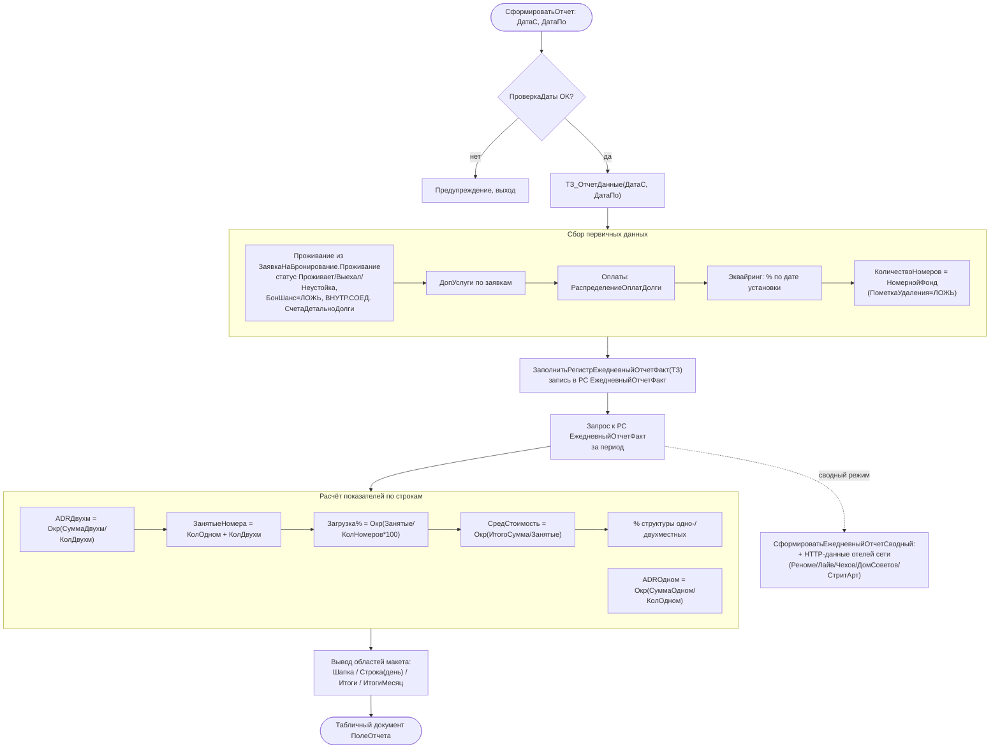

# Flowchart — Ежедневный факт-отчёт (ADR / загрузка / выручка)

> `DataProcessors.ЕжедневныйОтчетФакт.Форма` + `CommonModules.ЕжедневныйОтчетФакт`. Доверие 🟢.

**Защита:** все деления обёрнуты `Если знаменатель=0 Тогда 0` (🟢).
**Особенность:** отчёт сначала перезаписывает витрину РС `ЕжедневныйОтчетФакт`, потом читает её обратно (🟢).
