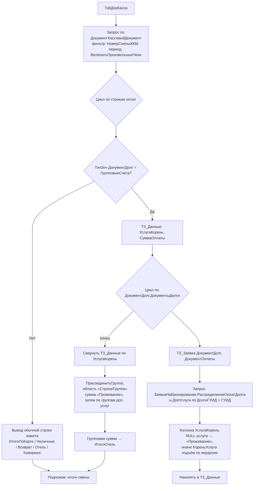

# Flowchart — Аудит: ОтчетКассоваяСмена, групповые счета

> Добавлено повторным извлечением №1 (коммит `Изменения ПСН`, 2026-06-18).
> Источник: `Reports/ОтчетКассоваяСмена/Forms/ФормаОтчета/Module.bsl`. Доверие 🟢.

Новая ветка отчёта по кассовой смене: для оплат по групповому счёту (`ДокументСсылка.ГрупповыеСчета`) выводится разбивка суммы по корневым группам доп. услуг.

**Примечания**
- `ТЗ_Заявка` и `ПрисоединитьГруппа` — новые функции, выделены из ранее inline-кода. 🟢
- `ТабДокКасса_1` — мёртвый клон старой версии (без обработки `ГрупповыеСчета`), не вызывается. 🟡 кандидат на удаление.
- Отчёт строится вручную через `ТабличныйДокумент` (без СКД); новых параметров СКД нет. 🟢
