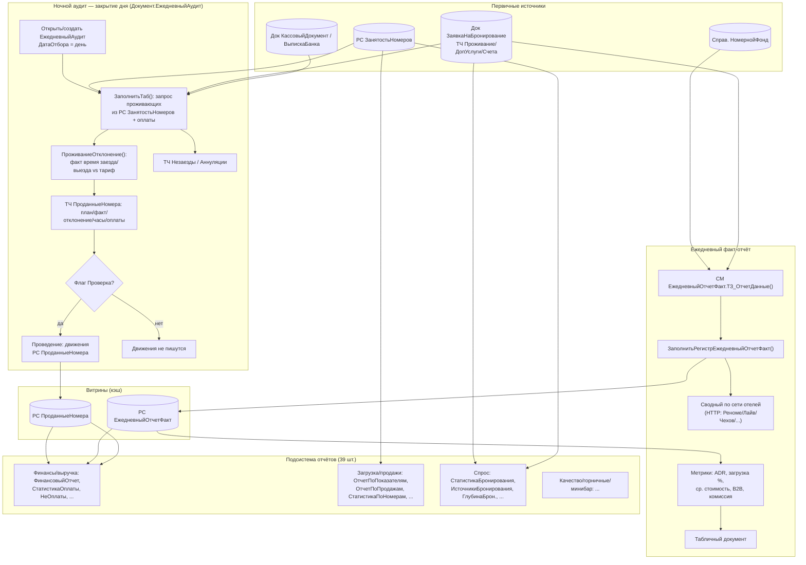

# Flowchart — Модуль «Аудит и отчётность»

> Поток уровня модуля: ночной аудит (закрытие дня) → витрины РС → управленческие/операционные отчёты. Доверие: 🟢 подтверждено кодом, 🟡 выведено.

**Ключевые узлы:**
- 🟢 `Проверка` — тумблер: без него аудит не пишет движения.
- 🟢 Витрина РС `ПроданныеНомера` наполняется только аудитом, читается финансовыми отчётами.
- 🟢 Факт-отчёт перед выводом **пересчитывает и перезаписывает** РС `ЕжедневныйОтчетФакт`.
- 🟡 Сводный отчёт собирает данные по 5 отелям сети по HTTP (имена захардкожены).
