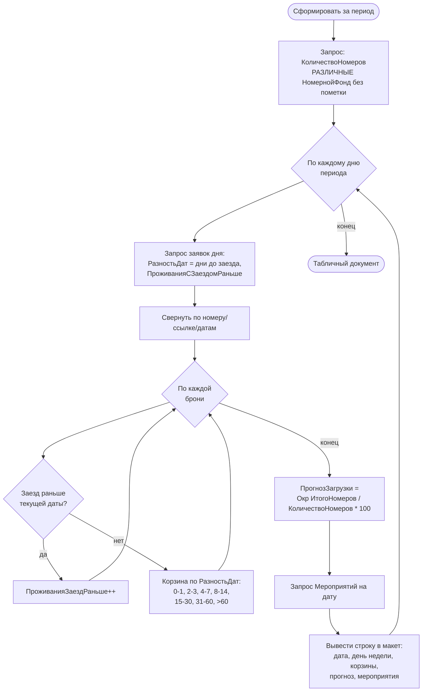

# Flowchart — `ГлубинаБронирования.СформироватьНаСервере`

Источник: `DataProcessors/ГлубинаБронирования/Forms/Форма/Module.bsl:22-195`. Доверие: 🟢.

Замечания:
- «Глубина» = число дней между датой создания брони и датой заезда; распределяется по 7 корзинам — показывает, насколько заранее бронируют.
- `ПрогнозЗагрузки` — % занятости номерного фонда на день.
- `Мероприятия` города на дату выводятся как фактор спроса.
- 🔴 В модуле 4 почти идентичные версии (`СформироватьНаСервере`, `_1`, `_2`, `_3`) — дублирование, активная версия неочевидна.
