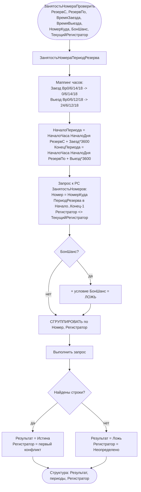

# Flowchart — `ДокументыСервер.ЗанятостьНомераПроверить`

Источник: `CommonModules/ДокументыСервер/Module.bsl:264-311` (+ `ЗанятостьНомераПериодРезерва:231-262`). Доверие: 🟢.

Замечания:
- `Результат = Истина` означает **номер занят** (конфликт), что в `ОбработкаПроведения` приводит к отказу.
- Бронь «БонШанс» не конфликтует с другими «БонШанс»-резервами (фильтр `БонШанс = ЛОЖЬ`). 🟡
- Период резерва считается с точностью до часа; выезд исключает последний час (`Конец-1` в запросе и `ТемпПо-1` в проведении).
