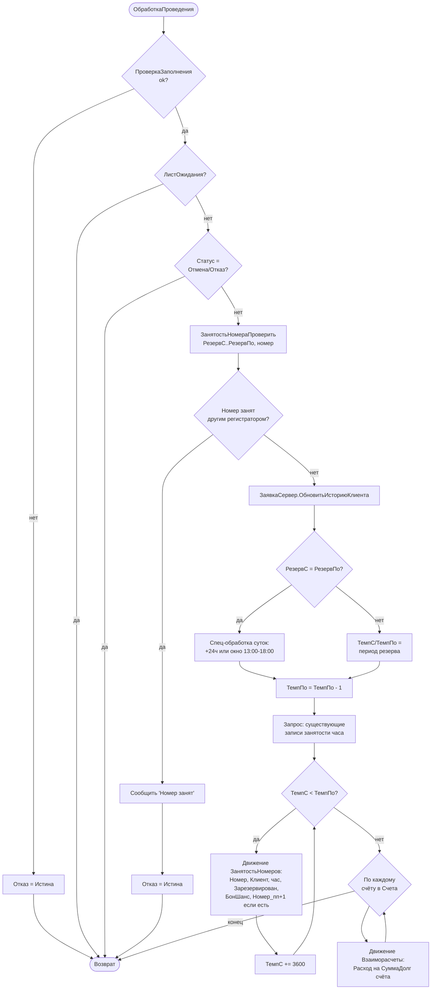

# Flowchart — `ЗаявкаНаБронирование.ОбработкаПроведения`

Источник: `Documents/ЗаявкаНаБронирование/ObjectModule.bsl:4-140`. Доверие: 🟢.

Замечания:
- Почасовой цикл создаёт по записи `ЗанятостьНомеров` на каждый час интервала резерва — гранулярность доступности = 1 час.
- `Номер_пп` инкрементируется при наложении резервов в одном часе (мульти-резерв/переселение).
- 🔴 Движения `Долги`/`ОстаткиПродукции`/`ПродажиТоваров` заявлены в регистраторах, но в этой процедуре не формируются (мёртвый/перенесённый блок `:96-138`).
