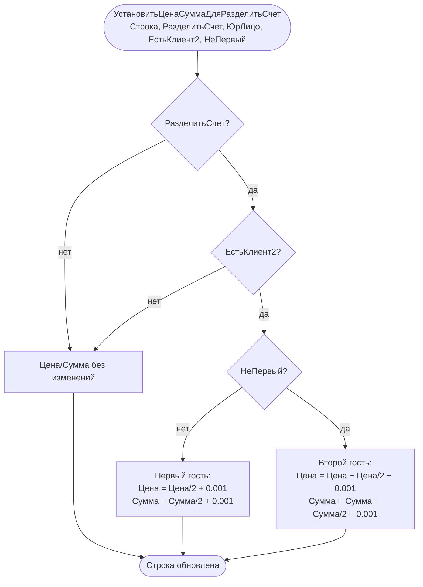

# Flowchart — Разделение счёта (`ЗаявкаСервер.УстановитьЦенаСуммаДляРазделитьСчет`)

Источник: `CommonModules/ЗаявкаСервер/Module.bsl:432-446` (и `:393-427` для детальных долгов). Доверие: 🟢.

Замечания:
- Корректирующие `+0.001 / −0.001` гарантируют, что сумма двух половин = исходной целой сумме при нечётных значениях (без потери копейки).
- В версии `_1` (`:411-427`) добавлено условие `Если НЕ ЮрЛицо` — для юрлиц счёт не делится; в основной версии эта проверка закомментирована. 🟡 поведенческое расхождение.
- Для детальных долгов (`СчетаДетальноДолги`) дополнительно корректируется `СуммаКЗакрытию`.
