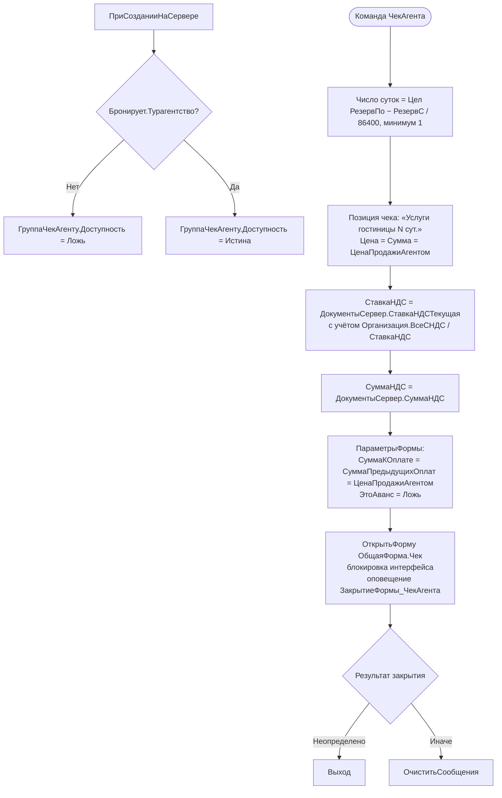

# Flowchart — Бронирование: ЧекАгента

> Добавлено повторным извлечением №1 (коммит `Изменения ПСН`, 2026-06-18).
> Источник: `Documents/ЗаявкаНаБронирование/Forms/ФормаДокумента/Module.bsl`. Доверие 🟢 (прямо из кода).

Печать «Чека агента» в документе `ЗаявкаНаБронирование` — чек ККМ на сумму продажи номера турагентством. Группа доступна только когда контрагент `Бронирует` помечен как турагентство.

**Примечания**
- Движений регистров не порождает: чек печатается через внешнюю общую форму `Чек` (поток ККТ/фискализации см. модуль Финансы). 🟢
- `ЗакрытиеФормы_ЧекАгента` — обработчик-заглушка (без постобработки результата чека). 🟡 возможный пробел: результат печати чека нигде не фиксируется в документе.
