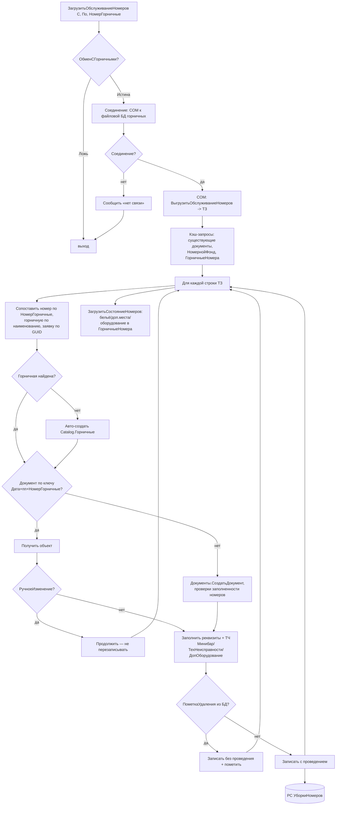

# Flowchart — Загрузка фактов уборки из БД горничных

`CommonModule.ОбменГорничныеСервер.ЗагрузитьОбслуживаниеНомеров`. Доверие: 🟢.

## Примечания
- 🟢 Защита ручных правок: документ с `РучноеИзменение=Истина` не перезаписывается.
- 🟢 Минибар сопоставляется по коду (`НоменклатураМиниБара.НайтиПоКоду`); цена берётся из карточки.
- 🟡 Аналогичные потоки: `ЗагрузитьОбслуживаниеПомещений` (ключ Дата+пп+Горничная), `ЗагрузитьСмены` (ключ ДатаСмены+Горничная).
