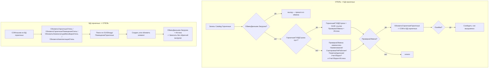

# Flowchart — Двусторонний обмен справочниками горничных

`Catalog.Горничные.ObjectModule` + `CommonModule.ОбменГорничныеСервер`. Доверие: 🟢.

## Примечания
- 🟢 Флаг `ОбменДанными.Загрузка` разрывает цикл «эхо» обмена.
- 🟢 Синхронизация `ГорничныеНомера` ↔ `НомернойФонд` по `НомерГорничные` — `DataProcessor.ОбновитьГорничныеНомера`.
