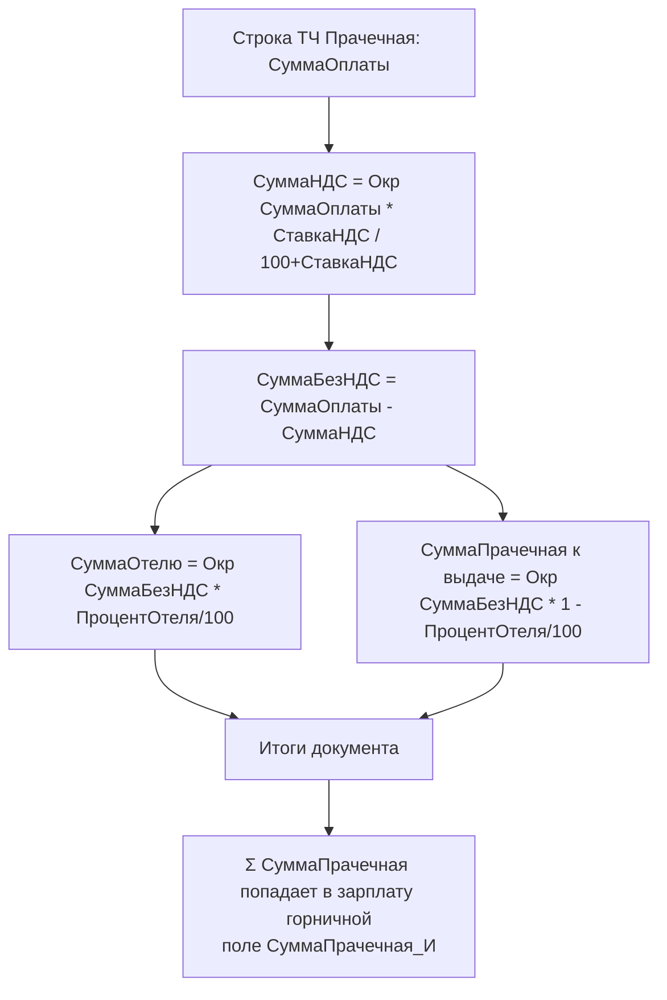

# Flowchart — Прачечная: деление выручки

`Document.ГорничныеПрачечная/Forms/ФормаДокумента/Module.bsl` → `ОбновитьСуммаПрачечная`. Доверие: 🟢.

## Примечания
- 🟢 `ПроцентОтеля` по умолчанию = 10 (`ПриСозданииНаСервере`).
- 🔴 Источник `СтавкаНДСЧисло` не разобран (вероятно настройка финмодуля).
