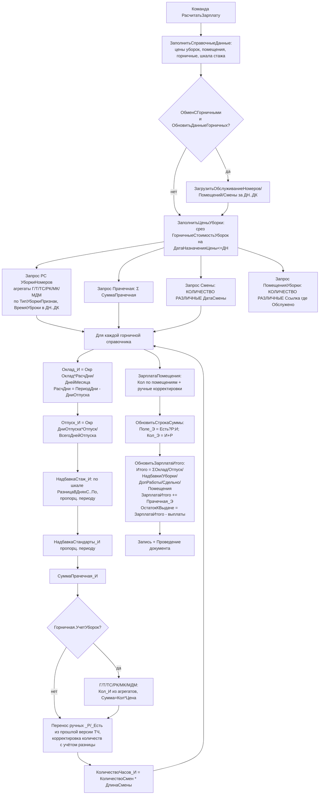

# Flowchart — Расчёт зарплаты горничных

`Document.ГорничныеЗарплата/Forms/ФормаДокумента/Module.bsl` → `РасчитатьЗарплатуДействие` / `РасчитатьЗарплатуНаСервере`. Доверие: 🟢.

## Примечания
- 🟢 Цены — срез последних на `ДН`; шкала стажа — срез на `ДК`.
- 🔴 Баг: клиентский `КоличествоЧасовНаКлиенте` использует `* 8` вместо `ДлинаСмены`.
- 🟡 Реквизиты/колонки по помещениям создаются динамически (`ДобавитьРеквизитыПомещения`).
