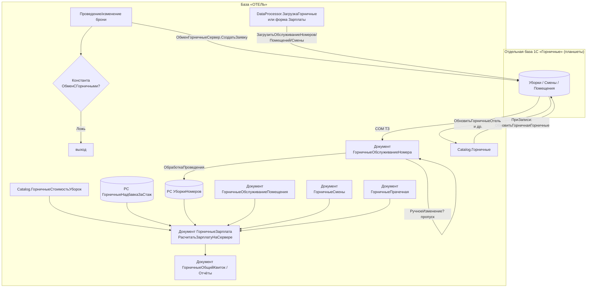

# Flowchart — Модуль «Горничные (Housekeeping)»

Уровень: detalhado. Доверие: 🟢 подтверждено / 🟡 выведено.

## Общий поток модуля

## Ключевые правила (резюме)
- 🟢 Обмен с БД горничных управляется `Константа.ОбменСГорничными`.
- 🟢 Уборки регистрируются в БД горничных, в «ОТЕЛЬ» загружаются и проводятся в РС `УборкиНомеров`.
- 🟢 Зарплата: модель И/Р/Э/Есть; сдельная часть только при `Горничная.УчетУборок`.
- 🟢 Прачечная: выручка делится после извлечения НДС по `ПроцентОтеля`.

Детальные потоки:
- [Горничные-РасчётЗарплаты](Горничные-РасчётЗарплаты.md)
- [Горничные-ЗагрузкаУборок](Горничные-ЗагрузкаУборок.md)
- [Горничные-Прачечная](Горничные-Прачечная.md)
- [Горничные-ОбменСправочников](Горничные-ОбменСправочников.md)
