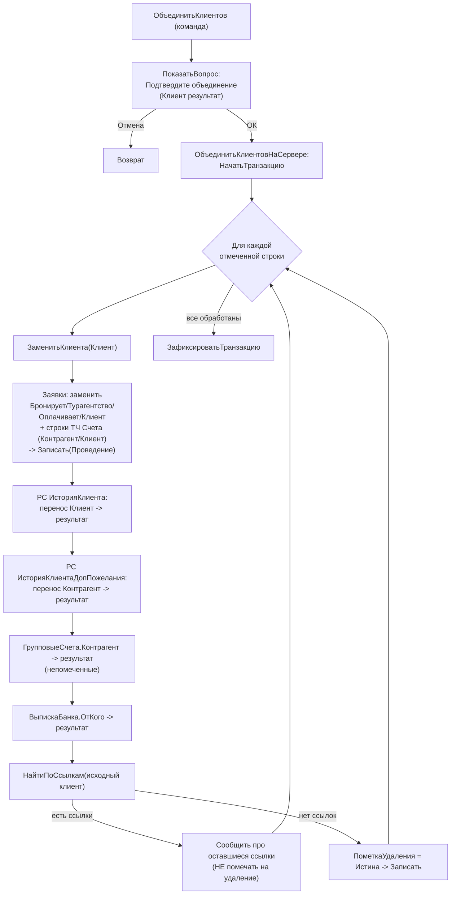

# Flowchart дедупликации `ОбъединитьКлиентов` / `ЗаменитьКлиента`

Файл: `ПСН_РЕНОМЕ__АУДИТ/src/DataProcessors/КлиентыОбъединиение/Forms/ФормаОбъединениеКонтрагентов/Module.bsl:185-417` 🟢

Слияние дублей клиента: один клиент выбирается как «результат», во всех ссылающихся документах остальные клиенты заменяются на него, после чего исходный помечается на удаление (если на него больше нет ссылок).

## Ключевые правила 🟢

1. **Клиент-результат исключается** из набора заменяемых: при попытке отметить строку с `КлиентРезультат` отметка сбрасывается (`ТаблицаОтборОтметкаПриИзменении`, `Module.bsl:421-425`).
2. **Документы-приёмники замены**: `ЗаявкаНаБронирование` (реквизиты Бронирует/Турагентство/Оплачивает/Клиент + ТЧ Счета), `ГрупповыеСчета`, `ВыпискаБанка`; регистры `ИсторияКлиента`, `ИсторияКлиентаДопПожелания`.
3. **Безопасное удаление**: исходный клиент помечается на удаление только если `НайтиПоСсылкам` не вернул ни одной ссылки (`Module.bsl:400-412`).
4. **Поиск дублей по ИНН** (вход в процесс): `КлиентыДвойныеИНН` — группировка `Справочник.Клиенты` по ИНН с `Количество > 1` и `ТипКлиента = ЮрЛицо` (`КлиентыДвойныеИНН/.../Module.bsl:34-78`).

## ⚠ Замечания по корректности

- Нарушение паттерна транзакций: `Записать(Проведение)` внутри цикла внутри транзакции без `Попытка/Исключение` — при сбое `ОтменитьТранзакцию` не вызывается (`BeginTransactionBeforeTryCatch`).
- Фильтр дублей охватывает только `ЮрЛицо`; дубли физлиц по ИНН не выявляются этим отчётом.
