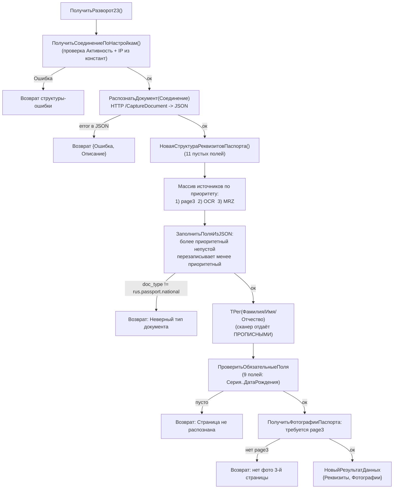

# Flowchart функции `PassportBoxВызовСервера.ПолучитьРазворот23`

Файл: `ПСН_РЕНОМЕ__АУДИТ/src/CommonModules/PassportBoxВызовСервера/Module.bsl:50-92` 🟢

Распознавание разворота 2-3 паспорта РФ через HTTP-сканер PassportBox. Объединяет до трёх источников полей с разными приоритетами и проверяет обязательные реквизиты.

## Ключевые правила 🟢

1. **Приоритет источников** возрастающий: `page3` (серия+номер) < OCR разворота < MRZ (контрольные суммы). Пустое значение никогда не перезаписывает заполненное (`Module.bsl:464-479`).
2. **ТРег** применяется к ФИО, т.к. сканер возвращает прописные буквы; корректно обрабатывает фамилии через дефис (`Module.bsl:77-79`).
3. **9 обязательных полей** паспорта: Серия, Номер, ДатаВыдачи, КодПодразделения, Фамилия, Имя, Отчество, Пол, ДатаРождения (`ОбязательныеПоляПаспорта`, `Module.bsl:418-430`).
4. **Фото 2-й страницы отключено** (закомментировано); обязательна только page3 (`Module.bsl:518-534`).
5. Все исключения перехватываются и конвертируются в результат-ошибку (нет «проброса наверх»).
