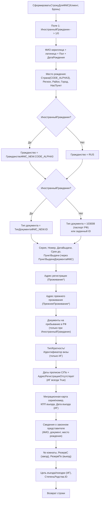

# Flowchart функции `СформироватьСтрокуДляФМС`

Файл: `ПСН_РЕНОМЕ__АУДИТ/src/DataProcessors/ВыгрузкаДляФМС/Forms/Форма/Module.bsl:138-429` 🟢

Формирует одну строку CSV для миграционного учёта ФМС по паре «клиент + бронь». Разделитель `;`, формат файла `#v.2.0.0`. ~94 поля, ветвление по признаку `ИностранныйГражданин`.

## Ключевые правила формата 🟢

1. **Шапка файла**: первая строка — `#v.2.0.0;;;...;` (фиксированное число `;`) (`Module.bsl:91`).
2. **Имя файла**: `<первые 10 символов ТекущаяДата>.csv`, каталог из константы `ПАПКА_ВыгрузкаДляФМС` (`Module.bsl:105-111`).
3. **Признак иностранца** управляет десятками ветвлений: для россиян поля визы/пребывания/миграционной карты пустые, гражданство = `RUS`, тип документа = `103008`.
4. **`ПунктВыдачиДокументаФМС`** — полиморфный резолвер: Строка -> как есть, `СправочникСсылка.ПунктыВыдачиФМС_NEW` -> `Формат(.ID, "ЧГ=")`, иначе пусто (`Module.bsl:432-442`).
5. **Даты** форматируются `ДФ=dd.MM.yyyy`; целочисленные ID — `Формат(..., "ЧГ=")` (без разделителей групп).
6. **Источник строк выгрузки**: брони с `ВремяЗаездаТочное` = дата заезда; на `Клиент` и (если задан) `Клиент2` создаются отдельные строки (`ДатаЗаездаПриИзмененииНаСервере`, `Module.bsl:13-43`).

## 🔴 Пробелы

- Хардкод `ПаспортРФ_ID = 103008` в коде (магическое число, `Module.bsl:181`).
- Множество закомментированных вариантов полей (`_OLD`) — затрудняет реконструкцию точной версии формата.
- Привязка к внешним справочникам ФМС (`СтраныФМС_NEW`, `ТипДокументаФМС_NEW`, `ПунктыВыдачиФМС_NEW` с реквизитами `CODE_ALPHA3`, `ID`, `CODE_0`) вне домена — структура справочников не разбиралась.
