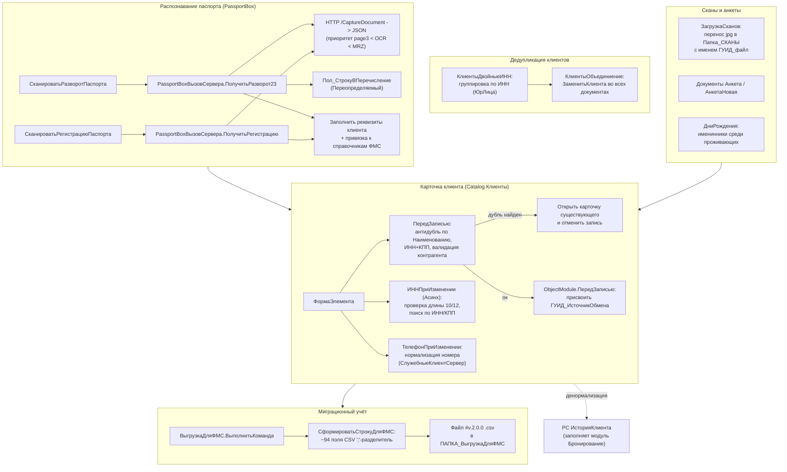

# Flowchart модуля «Гости и регистрация»

Модульная карта потоков управления домена гостей/клиентов: ведение карточки клиента, дедупликация, миграционный учёт (ФМС), распознавание паспортов (PassportBox), загрузка сканов, анкеты, дни рождения.

Шкала доверия: 🟢 ПОДТВЕРЖДЕНО (извлечено из кода) · 🟡 ВЫВЕДЕНО · 🔴 ПРОБЕЛ.

## Точки входа домена

| Точка входа | Файл | Триггер |
|---|---|---|
| Карточка клиента | `Catalogs/Клиенты/Forms/ФормаЭлемента/Module.bsl` | интерактивное открытие |
| Сканирование паспорта | там же, `СканироватьРазворотПаспорта_Команда` / `СканироватьРегистрациюПаспорта_Команда` | команда формы |
| Выгрузка ФМС | `DataProcessors/ВыгрузкаДляФМС/Forms/Форма/Module.bsl` | команда `ВыполнитьКоманда` |
| Дедуп по ИНН | `DataProcessors/КлиентыДвойныеИНН`, `DataProcessors/КлиентыОбъединиение` | команда формы |
| Загрузка сканов | `DataProcessors/ЗагрузкаСканов/Forms/Форма/Module.bsl` | при открытии + `ПрикрепитьФото` |
| Дни рождения | `DataProcessors/ДниРождения/Forms/Форма/Module.bsl` | при создании (параметр Вызов) |
| Настройки сканера | `DataProcessors/НастройкиPassportBox/Forms/Форма/Module.bsl` | команда формы |

## Связи с другими модулями

- **Бронирование** — `ЗаявкаНаБронирование.Клиент/Клиент2/Оплачивает/Бронирует/Турагентство`; денормализация в `РС ИсторияКлиента` пишется при проведении заявки (модуль Бронирование).
- **Финансы и касса** — `ГрупповыеСчета.Контрагент`, `ВыпискаБанка.ОтКого` (замена при объединении клиентов).
- **Ценообразование** — `КатегорииКлиентов.Скидка`, `СкидкиКлиента`.
- **Интеграции и обмен** — `ГУИД_ИсточникОбмена`, `НеУчаствуетВОбмене`, перенос клиентов из Реноме/Чехов.
