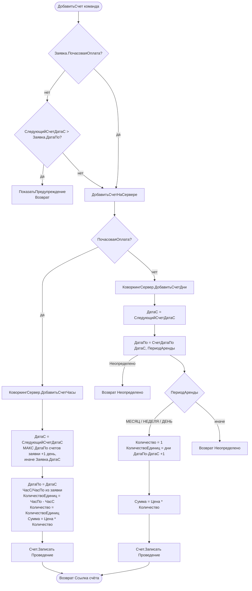

# Функция: Формирование счёта из заявки коворкинга

Файлы 🟢:
- `ПСН_РЕНОМЕ__АУДИТ/src/CommonModules/КоворкингСервер/Module.bsl:349-505` (`ДобавитьСчетЧасы`, `ДобавитьСчетДни`, `СледующийСчетДатаС`, `СчетДатаПо`)
- `ПСН_РЕНОМЕ__АУДИТ/src/DataProcessors/КоворкингЗаявкаОбработка/Forms/Форма/Module.bsl:321-365` (`ДобавитьСчет`, `ДобавитьСчетНаСервере`)

Существует **дублирующая** версия в `CommonModules/КоворкингКлиент/Module.bsl:2-188` (`ДобавитьСчетЧасы/ДобавитьСчетДни` через `ОткрытьФорму`, без `Записать`) — клиентский вариант, помечен признаками неполноты (`//Возврат` закомментирован). Каноническим является серверный путь `КоворкингСервер`.

## Ключевые расчёты дат 🟢

**`СледующийСчетДатаС`** (`:326-345`): берёт `МАКСИМУМ(КоворкингСчета.ДатаПо)` по непомеченным счетам заявки; если есть — `+86400` (следующий день), иначе `Заявка.ДатаС`. Так счета идут непрерывной цепочкой без разрывов.

**`СчетДатаПо(ДатаС, ПериодАренды)`** (`:455-505`):
- `МЕСЯЦ`: если день ДатаС = 1 → конец месяца; иначе → та же дата следующего месяца минус 1 день (календарный месяц от любого числа). Перенос года при Месяц>12.
- `НЕДЕЛЯ`: `ДатаС + 6*86400`.
- `ДЕНЬ`/`ЧАС`: `НачалоДня(ДатаС)`.
- иначе → `Неопределено`.
Возвращает `НачалоДня(ДатаПо)`.

## 🔴/🟡 Замечания
- 🟡 Для `МЕСЯЦ`/`НЕДЕЛЯ`/`ДЕНЬ` `Количество` жёстко = 1 (вся пропорциональная логика — деление на длину месяца/недели, учёт выходных — **закомментирована**). `КоличествоЕдиниц` (информативное число дней) считается отдельно.
- 🔴 Дублирование `ДобавитьСчетЧасы/ДобавитьСчетДни/СчетДатаПо/ЗаполнитьСрокиАренды/РабочийДень` между `КоворкингСервер` и `КоворкингКлиент` (две почти идентичные копии, расхождение в `Возврат НачалоДня` у `СчетДатаПо`).
- 🔴 Целый блок «ВключатьВыходные» (`РазницаВДняхВключатьВыходные`, `РабочийДень`, `ЭтоРабочийДень`, `ЗаполнитьСрокиАрендыВключатьВыходные`) помечен «Не используется» — мёртвый код с `Перейти ~Продолжение`.
