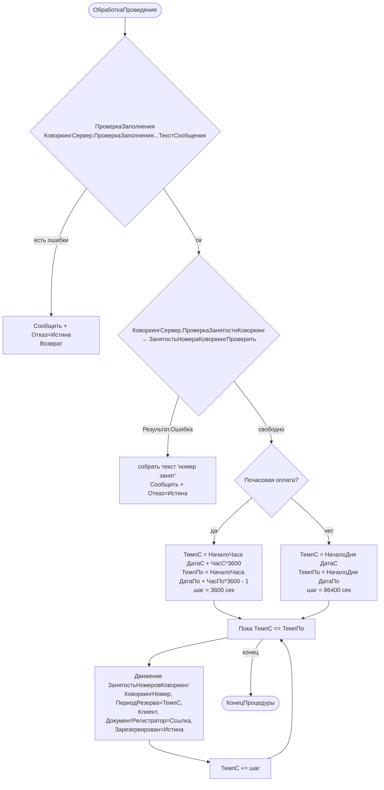

# Функция: ОбработкаПроведения (КоворкингЗаявка / КоворкингСчета)

Файлы:
- `ПСН_РЕНОМЕ__АУДИТ/src/Documents/КоворкингЗаявка/ObjectModule.bsl:3-45` 🟢
- `ПСН_РЕНОМЕ__АУДИТ/src/Documents/КоворкингСчета/ObjectModule.bsl:3-44` 🟢

Логика почти идентична в обоих документах. Различия: заявка берёт номер из `ЭтотОбъект.КоворкингНомер` и флаг почасовости из `КоворкингНомер.ПочасоваяОплата`; счёт берёт номер из `КоворкингЗаявка.КоворкингНомер`, а флаг — из собственного реквизита `ПочасоваяОплата`.

## Алгоритм проверки занятости — `ЗанятостьНомераКоворкингПроверить` 🟢
`ПСН_РЕНОМЕ__АУДИТ/src/CommonModules/КоворкингСервер/Module.bsl:111-178`

1. Период проверки: `НачалоПериодаРезерва = ДатаС + ЧасС*3600`; `КонецПериодаРезерва = ДатаПо + (ЧасПо=0 ? 0 : ЧасПо*3600-1)`.
2. Запрос группирует `ЗанятостьНомеровКоворкинг` по `КоворкингНомер, Регистратор` для пересекающегося периода (`МЕЖДУ &ПериодН И &ПериодК`) по нужному номеру.
3. **Двухпроходный поиск конфликта** (нетривиально):
   - 1-й проход: ищет конфликтную запись, **пропуская** записи-регистраторы типа `КоворкингЗаявка` (т.е. ищет конфликт со *счетами* других заявок); для заявки исключает счета своей заявки, для счёта — сам себя.
   - 2-й проход (если не найдено): ищет среди записей типа `КоворкингЗаявка`, исключая собственную заявку/родительскую заявку счёта.
   - Смысл: заявка резервирует «черновой» период, счёт — фактический; конфликт со счётом другой заявки приоритетнее.
4. `Результат = (Регистратор <> Неопределено)`; возвращается структура `{Результат, НачалоПериодаРезерва, КонецПериодаРезерва, Регистратор}`.

## 🔴/🟡 Замечания
- 🔴 Движения формируются **по одной записи на каждый час/день** периода — на длинном посуточном периоде (месяц аренды) это десятки записей РС на документ. Нет агрегации.
- 🟡 Несогласованность возвратов `ПроверкаЗаполнения`: в `КоворкингЗаявка` функция возвращает `Истина` при ошибке (`Отказ = ПроверкаЗаполнения()`), в `КоворкингСчета` — `Ложь` при ошибке (`Отказ = НЕ ПроверкаЗаполнения()`). Поведение эквивалентно, но инверсия — источник путаницы.
- 🟡 `КоворкингЗаявка.ПередЗаписью_Вариант` (запрет пометки удаления при наличии счетов) назван `_Вариант` и, судя по имени, как обработчик события **не подключён** — фактическую защиту даёт `КоворкингКлиент.ПроверкаУдаленияЗаявки` на форме.
