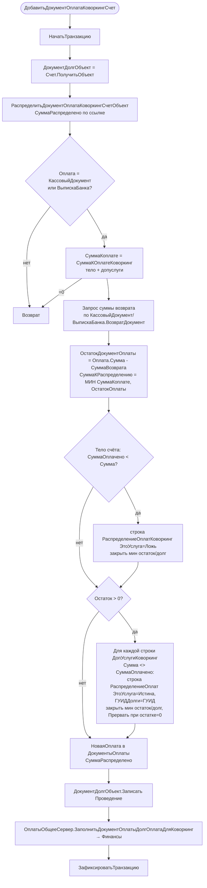

# Функция: Распределение оплат по счёту коворкинга

Файл 🟢: `ПСН_РЕНОМЕ__АУДИТ/src/CommonModules/КоворкингСервер/Module.bsl:637-824`
Процедуры: `ДобавитьДокументОплатаКоворкингСчет`, `РаспределитьДокументОплатаКоворкингСчетОбъект`, `СуммаКОплатеКоворкинг`, `ОбновитьОплатыКоворкинг`, `УдалитьДокументОплаты`, `УменьшитьОплатыКоворкингСчетаСуммаВозврата`.

Счёт коворкинга закрывается оплатами (`КассовыйДокумент`/`ВыпискаБанка`). Сумма к оплате = долг по самому счёту (`Сумма - СуммаОплачено`) **плюс** долг по строкам доп. услуг коворкинга (`ДопУслугиКоворкинг.Итог("Сумма") - Итог("СуммаОплачено")`). Оплата распределяется сначала на тело счёта, затем на строки допуслуг.

## Алгоритм частичного возврата — `УменьшитьОплатыКоворкингСчетаСуммаВозврата` 🟢 (`:2-53`)
1. Транзакция; находит строки `ДокументыОплаты` и `РаспределениеОплатКоворкинг` по документу оплаты.
2. Если распределённая сумма ≤ суммы возврата → удаляет строки целиком + вызывает `ОплатыОбщееСервер.УдалитьДокументОплатыДокументДолгДолгОплата`.
3. Иначе уменьшает строки распределения по очереди на сумму возврата (последнюю — частично), затем синхронизирует `ОплатыОбщееСервер.ДобавитьЗаменитьДокументОплатыДолгОплата`.
4. `ДокументДолгОбъект.Записать(Проведение)` → `ЗафиксироватьТранзакцию`.

## Пересчёт «с нуля» — `ОбновитьОплатыКоворкинг` 🟢 (`:791-824`)
Обнуляет `СуммаРаспределено`, `СуммаОплачено` (тело и допуслуги), очищает `РаспределениеОплатКоворкинг`, затем заново прогоняет `РаспределитьДокументОплатаКоворкингСчетОбъект` по каждой строке `ДокументыОплаты`; строки с нулевым распределением удаляются.

## 🔴/🟡 Замечания
- 🟡 `СуммаОплачено` шапки счёта пересчитывается в `КоворкингСчета.ПередЗаписью` как `Итог("СуммаОплаты")` по `РаспределениеОплатКоворкинг` — единственный источник истины суммы оплат.
- 🔴 Транзакции открываются в нескольких процедурах (`ДобавитьДокументОплата...`, `Уменьшить...`, `УдалитьДокументСписания...`) с `НачатьТранзакцию/ЗафиксироватьТранзакцию` **без `Попытка/Исключение`** — нарушение канонического паттерна транзакций; при ошибке `Записать` транзакция повисает.
- 🟡 Логика распределения дублирует паттерн долгов брони (`ЗаявкаНаБронирование.СчетаДетально*` / `ЗаявкаСервер`) — параллельная реализация того же контура взаиморасчётов под коворкинг.
