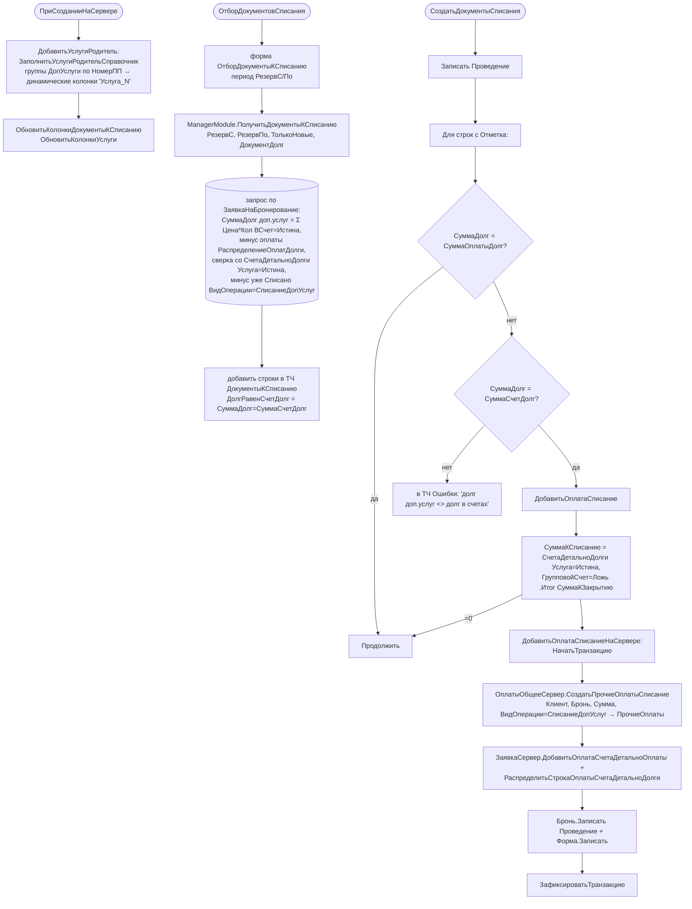

# Функция: Списание долга за доп. услуги (СписаниеДопУслуг)

Файлы 🟢:
- `ПСН_РЕНОМЕ__АУДИТ/src/Documents/СписаниеДопУслуг/ManagerModule.bsl` (запросы `ПолучитьДокументыКСписанию`, `ЗаполнитьУслугиРодительСправочник`)
- `ПСН_РЕНОМЕ__АУДИТ/src/Documents/СписаниеДопУслуг/Forms/ФормаДокумента/Module.bsl` (создание оплат-списаний, печать акта)

`СписаниеДопУслуг` — документ-реестр: не имеет `ObjectModule`/`ОбработкаПроведения` и **не делает движений по регистрам**. Вся логика — на форме. Назначение: списать (закрыть) фактический долг гостя за доп. услуги, создав документы оплаты `ПрочиеОплаты` с `ВидОперации = СписаниеДопУслуг` и распределив их по долгам брони.

## Ключевые правила 🟢
- **Источник долга** — ТЧ `ЗаявкаНаБронирование.ДопУслуги` со строками `ВСчет = Истина` (`Сумма = Цена*Количество`), сверяется со `СчетаДетальноДолги` (`Услуга = Истина`).
- **Предохранитель**: списание создаётся только если `СуммаДолг = СуммаСчетДолг` (долг доп.услуг совпадает с долгом в счетах); иначе — строка в ТЧ `Ошибки`, документ списания не создаётся.
- **Снятие отметки** на форме: при изменении отметки/командой «Установить флажки» строка сбрасывается, если `НЕ ДолгРавенСчетДолг` или `СуммаДолг = СуммаОплатыДолг` (нечего списывать).
- **Удаление списания** (`УдалитьДокументСписанияНаСервере`): находит строки `СчетаДетальноОплаты` с `ДокументОплаты.ВидОперации = СписаниеДопУслуг` и откатывает их через `ЗаявкаСервер.УдалитьСтрокаОплатыНаСервере`.
- **Динамические колонки** «Услуга_N» (`РеквизитФормы`/`ИзменитьРеквизиты`) формируются по группам справочника `ДопУслуги` (поле `ЗаголовокОтчеты`, сортировка `НомерПП`); суммы группируются `ОбщийФункционалСервер.ВерхняяПапка` (родительская услуга).

## Печать акта 🟢 (`ПечатьАктаНаСервере`)
Выбор макета области по организации (`НастройкиСервер.ЭтоРеноме/ЭтоЛайв/ЭтоДомСоветов/ЭтоЧехов/ЭтоСтритАрт`) из единого макета `АктСписания`; колонки = группы услуг; строки = заявки с фактическим списанием.

## 🔴/🟡 Замечания
- 🔴 Транзакции в `ДобавитьОплатаСписаниеНаСервере` и `УдалитьДокументСписанияНаСервере` — без `Попытка/Исключение` (нарушение `BeginTransactionBeforeTryCatch`).
- 🔴 Мёртвый код: `ПолучитьМакетИмяАкта` помечен «Не Используется»; `УсловноеОформлениеЗагрузить_Пример`.
- 🟡 ТЧ `ДокументыКСписанию.ДокументДолг` типизирована только как `DocumentRef.ЗаявкаНаБронирование` — групповые счета/иные регистраторы долга не охвачены.
- 🔴 Печать акта повторно дёргает `ПолучитьДокументыКСписанию` в цикле по строкам ТЧ (запрос в цикле, `CreateQueryInCycle`).
