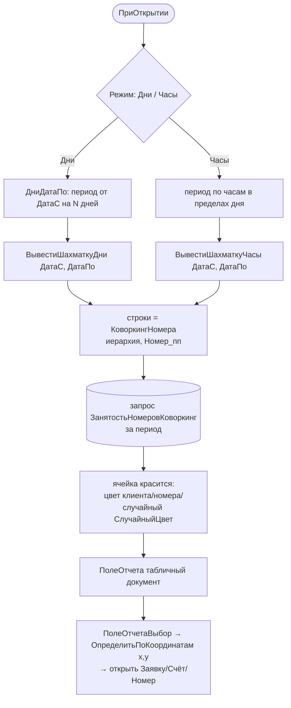

# Функция: Шахматка коворкинга (КоворкингШахматка)

Файл 🟢: `ПСН_РЕНОМЕ__АУДИТ/src/DataProcessors/КоворкингШахматка/Forms/Форма/Module.bsl` (1670 строк)
Макет: `DataProcessors/КоворкингШахматка/Templates/МакетШахматкаДни/Template.mxlx`

Визуализирует занятость коворкинг-мест в табличном документе: строки — коворкинг-номера, столбцы — дни (`ВывестиШахматкуДни`) или часы (`ВывестиШахматкуЧасы`). Источник — `РегистрСведений.ЗанятостьНомеровКоворкинг`.

## Навигация по клику 🟢
- `ПолеОтчетаВыбор` (`:1200`) → `ОпределитьПоКоординатам(x, y, ДниЧасы)` (`:1228`) вычисляет номер/дату из координат области и открывает связанный документ.
- Команды панели: `КоворкингЗаявки`, `КоворкингСчета`, `КоворкингНомера`, `КоворкингДопУслуги`, `КоворкингДокументы` — открытие соответствующих списков/обработки.

## 🔴/🟡 Замечания
- 🔴 Массивный техдолг: дубли-версии `ВывестиШахматкуДни_1` (`:443`), `ЗаполнитьНомерКоворкинг_1`, мёртвые `ТЕСТ`/`ТЕСТНаСервере` (`:1286-1329`), `ИмяОбработки_ПеренесеноВОбщийМодуль` (`:1166`), `ВывестиШахматку(ДатаС,ДатаПо,Детализация)` (`:1329`) — несколько параллельных реализаций отрисовки.
- 🟡 Цветовая раскраска (`СлучайныйЦвет`, поля `ЦветНомераR/G/B` в `КоворкингНомера`) повторяет паттерн основной шахматки размещения (модуль «Размещение и номерной фонд») — параллельная логика.
- 🔴 Внутренние циклы отрисовки (`:122-1145`) не разбирались построчно из-за объёма и дублирования; задокументирован контракт вход/выход.
