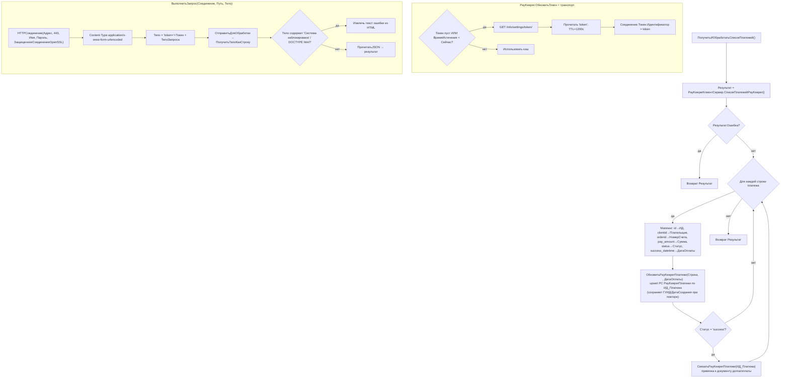

# Сценарий: Оплата и синхронизация платежей PayKeeper

`PayKeeperСервер.ПолучитьИОбработатьСписокПлатежей()` + транспорт `PayKeeper` (token-сессия). 🟢
Файлы: `ПСН_РЕНОМЕ__АУДИТ/src/CommonModules/{PayKeeper, PayKeeperСервер, PayKeeperКлиентСервер}/Module.bsl`.

## API-методы PayKeeper 🟢
| Операция | Endpoint | Примечание |
|---|---|---|
| Токен | `GET /info/settings/token/` | TTL 1200 c, ленивое обновление |
| QR / счёт СБП | `ПолучитьQRКод()` | возвращает Base64 JPEG + URL картинки |
| Статус платежа | `GET /info/payments/byid/?id=` | `status` |
| Список платежей | `GET /info/payments/bydate/?...&status[]=...&serverid[]=...` | по умолч. системы `93,52` |
| Возврат денег | `POST /change/payment/reverse/` | по статусам success/partially_refunded/refunded |
| Платёжные системы | `GET /info/systems/list/` | — |

## Структура соединения 🟢
`{Параметры{Адрес, ИмяПользователя, ПарольПользователя}, Токен{Идентификатор, ВремяИстечения}, Ошибка, Описание}`.
Аутентификация: Basic (логин/пароль в HTTPСоединение) + `token` в теле, HTTPS:443, OpenSSL.

## Статусы платежа
`success | failed | canceled | refunding | partially_refunded | refunded`.
