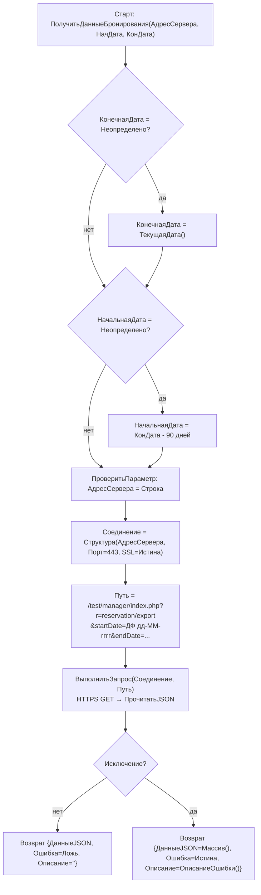

# Сценарий: Обмен с сайтом — получение бронирований

`ОбменСайт.ПолучитьДанныеБронирования(АдресСервера, НачальнаяДата, КонечнаяДата)` — `ПСН_РЕНОМЕ__АУДИТ/src/CommonModules/ОбменСайт/Module.bsl:2-25`. 🟢

## Примечания
- Дальше данные конвертируются в `Document.ЗаявкаСайт`, а затем в `ЗаявкаНаБронирование` (логика конвертации — модуль «Бронирование»).
- Парсинг строковых дат ответа — `ОбменСайт.СтрВДату()` с локализацией названий месяцев. 🟢
- Окно по умолчанию — последние 90 дней. 🟢
