# Модуль «Интеграции и обмен» — карта интеграций

Транспортный/протокольный слой внешних интеграций конфигурации «ОТЕЛЬ». Шкала доверия: 🟢 подтверждено кодом, 🟡 выведено, 🔴 пробел.

```mermaid
flowchart TB
    subgraph EXT["Внешние системы"]
        SITE["Сайт бронирования<br/>HTTPS /test/manager/...export"]
        GREENAPI["Green API<br/>api.green-api.com / media.green-api.com"]
        PK["PayKeeper / СБП<br/>HTTPS:443"]
        BANKBUH["Бухгалтерия / Банк<br/>(FTP XML)"]
        HOTELS["Базы сети отелей<br/>(FTP XML / план обмена)"]
        TABLET["Планшет горничных<br/>(COM V83)"]
        HTTPSRV["HTTP-сервисы заселений<br/>LIVE/CHEHOV/DomSovetov/StreetArt"]
    end

    subgraph DISP["Диспетчеры / оркестрация"]
        MES["МесенджерСервер<br/>МесенджерВключен / ОтправитьДанные_Месенджер"]
        PKS["PayKeeperСервер<br/>ПолучитьИОбработатьСписокПлатежей"]
        OG["ОбменГостиницы<br/>ВыполнитьОбменДанными"]
        OV["ОбменВыписка / ОбменБухгалтерияНДС"]
    end

    subgraph ADAPT["Адаптеры протокола"]
        WA["WhatsAppСервер"]
        TG["TelegramСервер"]
        GREENWA["GREEN_WhatsApp<br/>REST sendMessage/sendLink/sendFile/checkWhatsapp"]
        GREENTG["Обработка.GREEN_Telegram"]
        PKC["PayKeeperКлиентСервер → PayKeeper<br/>token-сессия, /info/* /change/*"]
        HM["HTTP_Модуль<br/>ПолучитьЗаселения/ЕжедневныйОтчетФакт"]
        OS["ОбменСайт<br/>ПолучитьДанныеБронирования"]
        OK["ОбменКартинкаСервер<br/>COMConnector"]
    end

    subgraph TRANS["Транспорт"]
        FTP["ФТПСервер<br/>FTPСоединение :21 пассивный"]
        XMLPLAN["Инфраструктура сообщений 1С<br/>СоздатьЗаписьСообщения / ВыбратьИзменения"]
        XDTO["XDTOPackages<br/>Cashbox_1_21_1 / ExchangeMessage 🔴"]
    end

    subgraph STORE["Хранение"]
        RSPK["РС PayKeeperПлатежи"]
        RSWA["РС РассылкаWhatsApp"]
        EP["Планы обмена<br/>ОбменГостиницы / ВГ_ВыпискаГостиницы / ОбменТест"]
        CONST["Константы<br/>GREEN*Token, Сервер*HTTP, флаги"]
    end

    SITE <--> OS
    HTTPSRV <--> HM
    GREENAPI <--> GREENWA
    GREENAPI <--> GREENTG
    PK <--> PKC
    BANKBUH <--> FTP
    HOTELS <--> FTP
    TABLET <--> OK

    MES --> WA --> GREENWA
    MES --> TG --> GREENTG
    PKS --> PKC --> RSPK
    OG --> XMLPLAN --> FTP
    OG --> EP
    OV --> FTP
    OV -.-> XDTO

    GREENWA --> CONST
    GREENTG --> CONST
    HM --> CONST
    MES --> RSWA

    classDef gap fill:#fdd,stroke:#c00;
    class XDTO gap;
```

## Ключевые сценарии (отдельные диаграммы)
- `Интеграции-ОбменСайт.md` — получение бронирований с сайта (HTTPS GET JSON).
- `Интеграции-ПланОбмена.md` — узловой обмен между базами (XML + FTP).
- `Интеграции-РассылкаWhatsApp.md` — рассылка через Green API.
- `Интеграции-PayKeeper.md` — приём оплаты и синхронизация платежей.

## Границы модуля (только связь, не дублируется)
- ФМС/PassportBox → «Гости»; СерверККМ/фискальное оборудование → «БПО»; `ОбменГорничныеСервер` → «Горничные»; документ «Выписка» (учёт) → «Финансы».
