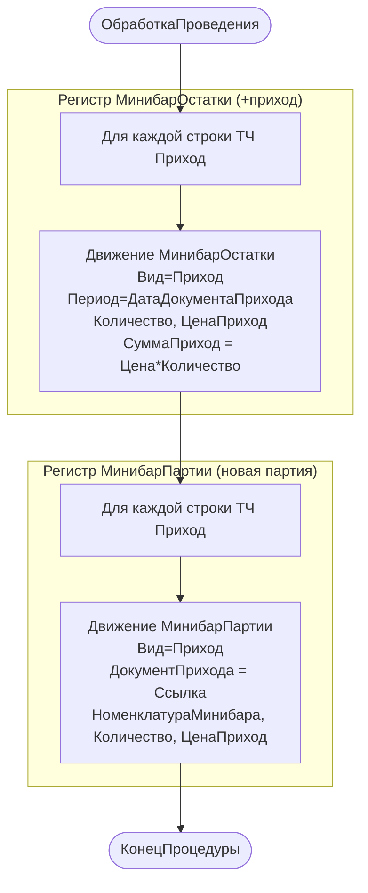

# Flowchart — `МинибарПриход.ОбработкаПроведения`

Файл: `ПСН_РЕНОМЕ__АУДИТ/src/Documents/МинибарПриход/ObjectModule.bsl:2-28`. Доверие: 🟢.

## Замечания
- 🟢 Каждый документ прихода = одна партия (ключ партии — `ДокументПрихода = Ссылка`). Это и обеспечивает FIFO в расходе.
- 🟢 Период движений = реквизит `ДатаДокументаПрихода`, не `Дата` документа — позволяет регистрировать приход «задним числом» по фактической дате поставки.
- 🟢 Проведение в привилегированном режиме (`postInPrivilegedMode=true`).
