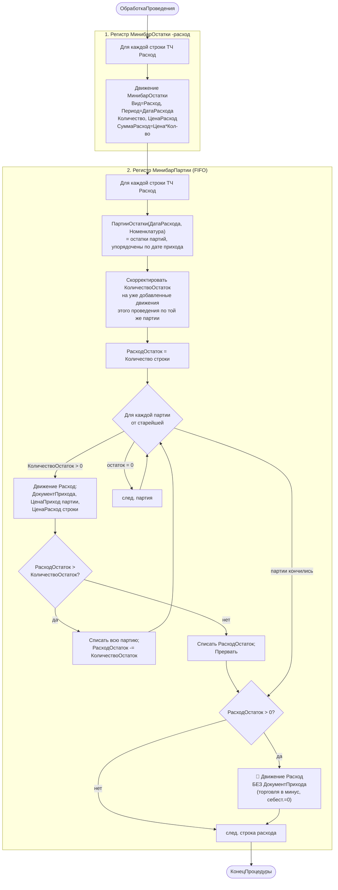

# Flowchart — `МинибарРасход.ОбработкаПроведения` (FIFO-списание партий)

Файл: `ПСН_РЕНОМЕ__АУДИТ/src/Documents/МинибарРасход/ObjectModule.bsl:2-98`. Доверие: 🟢.

Самый сложный алгоритм модуля. На каждую строку расхода списывает количество с партий минибара по принципу FIFO (старейшая партия первой).



## Подзапрос `ПартииОстатки`
```sql
ВЫБРАТЬ ДокументПрихода, НоменклатураМинибара, КоличествоОстаток, ЦенаПриход
ИЗ РегистрНакопления.МинибарПартии.Остатки(&Дата[Включая], НоменклатураМинибара = &Номенклатура)
ГДЕ КоличествоОстаток > 0
УПОРЯДОЧИТЬ ПО ДокументПрихода.ДатаДокументаПрихода   -- задаёт порядок FIFO
```

## Замечания
- 🟢 Коррекция остатков на движения текущего проведения (стр. 21-29) предотвращает двойное списание одной партии при нескольких строках расхода одной номенклатуры.
- 🔴 Ветка «без партии» (стр. 54-61) уводит `МинибарПартии` в минус и даёт нулевую себестоимость — допущение «торговли в минус».
- 🟢 `МинибарОстатки` и `МинибарПартии` пишутся независимо: первый — простой -расход, второй — разложение по партиям.
