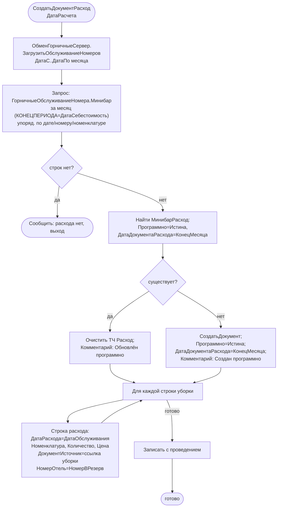

# Flowchart — `СоздатьДокументРасходНаСервере` (сбор расхода из уборок)

Файл: `ПСН_РЕНОМЕ__АУДИТ/src/DataProcessors/Минибар/Forms/Форма/Module.bsl:17-94`. Доверие: 🟢.

## Замечания
- 🟢 Идемпотентность по ключу (`Программно=Истина` + `ДатаДокументаРасхода=КонецМесяца`): повторный запуск перезаписывает один и тот же документ за месяц, а не плодит дубли.
- 🟢 Перед сбором подтягивает свежие факты из БД горничных (`ЗагрузитьОбслуживаниеНомеров`).
- 🟢 `ДокументИсточник` обеспечивает прослеживаемость каждой строки расхода до конкретной уборки номера.
- 🟡 Этот документ — продажа (`Списание=Ложь` по умолчанию); ручные документы списания (`Списание=Истина`) создаются отдельно.
