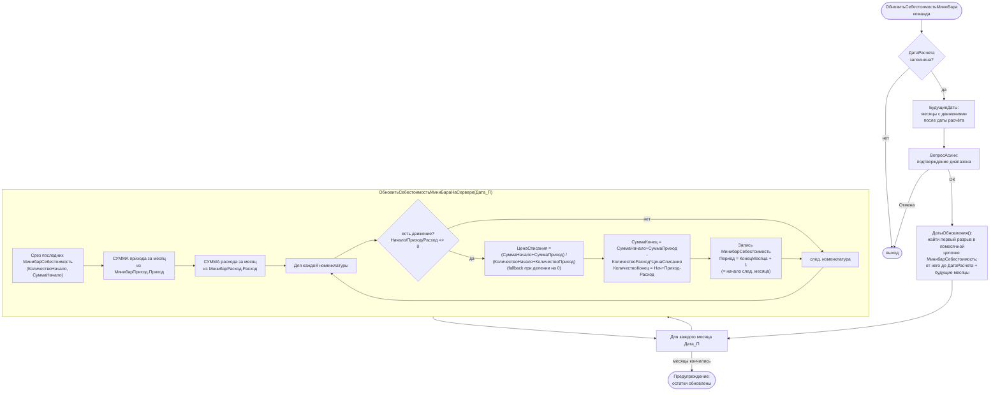

# Flowchart — Перерасчёт себестоимости минибара (средневзвешенная)

Файлы: `ПСН_РЕНОМЕ__АУДИТ/src/DataProcessors/Минибар/Forms/Форма/Module.bsl` — `ОбновитьСебестоимостьМиниБара` (808), `ДатыОбновления` (839), `БудущиеДаты` (891), `ОбновитьСебестоимостьМиниБараНаСервере` (968). Доверие: 🟢.

## Замечания
- 🟢 Метод оценки — **средневзвешенная** цена по остатку начала месяца + приходу месяца (не FIFO; FIFO применяется только для движений `МинибарПартии` при проведении расхода).
- 🟢 Результат пишется на **начало следующего месяца** (`Период = КонецМесяца + 1`), формируя переходящий остаток для следующего расчётного периода.
- 🟢 `ДатыОбновления` обеспечивает пересчёт цепочки месяцев от первого разрыва — защита от «дыр» в помесячной непрерывности.
- 🟡 Списание считается через `КоличествоРасход` без разделения на продажу/списание (флаг `Списание` здесь не учитывается; разделение применяется в отчёте «Прибыль»).
