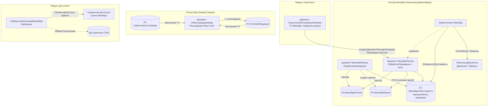

# Flowchart — Модуль «Минибар»

Уровень: detalhado. Доверие: 🟢 подтверждено / 🟡 выведено.

> Два контура: **Минибар** (`НоменклатураМиниБара` → `МинибарОстатки`/`МинибарПартии`/`МинибарСебестоимость`) и **«Бар»/Товары** (`Товары` → `ОстаткиПродукции`/`СебестоимостьТоваров`, документ `ИнвентарицацияБара`).

## Общий поток модуля

## Ключевые правила (резюме)
- 🟢 Приход создаёт партию на каждый документ (`МинибарПартии`, ключ = документ прихода).
- 🟢 Расход списывает партии по FIFO (порядок = дата прихода), цена партии = `ЦенаПриход`.
- 🔴 При нехватке партий — движение без партии (себестоимость 0), «торговля в минус».
- 🟢 Расход обычно формируется автоматически из уборок (`Программно=Истина`, идемпотентно за месяц).
- 🟢 Себестоимость — средневзвешенная, помесячный перенос остатков в `МинибарСебестоимость`.
- 🟢 Инвентаризация бара (контур `Товары`/`ОстаткиПродукции`) = Факт − Учёт.
- 🟢 Номенклатура минибара зеркалируется в `ДопУслуги` (продажа гостю) и в БД горничных.

Детальные потоки:
- [Минибар-РасходПроведение](Минибар-РасходПроведение.md) — FIFO-списание партий
- [Минибар-ПриходПроведение](Минибар-ПриходПроведение.md)
- [Минибар-Себестоимость](Минибар-Себестоимость.md) — средневзвешенная себестоимость и перенос
- [Минибар-СборРасходаИзУборок](Минибар-СборРасходаИзУборок.md)
- [Минибар-ИнвентаризацияБара](Минибар-ИнвентаризацияБара.md)
