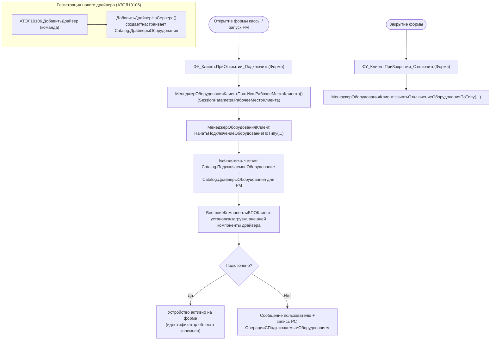

# Сценарий — Подключение устройства / драйвера (БПО)

> Источник: `CommonModules/ФУ_Клиент/Module.bsl` (`ПриОткрытии_Подключить`,
> `ВыполнитьПодключитьОтключитьОборудование`), вызовы `МенеджерОборудованияКлиент.*`,
> `DataProcessor.АТОЛ10106` (`ДобавитьДрайверНаСервере`).
> 🟡 Внутренние шаги загрузки внешней компоненты драйвера — внутри библиотеки БПО, не разбирались.

**Ключевые точки (🟢):**
- Привязка «устройство → рабочее место» через `Catalog.РабочиеМеста` + `SessionParameter.РабочееМестоКлиента`.
- Подключение/отключение — асинхронные вызовы `МенеджерОборудованияКлиент.Начать…ПоТипу` (callback-стиль).
- Драйвер физически — внешняя компонента, поставляемая `CommonTemplate.Драйвер…` (63 шаблона драйверов).
