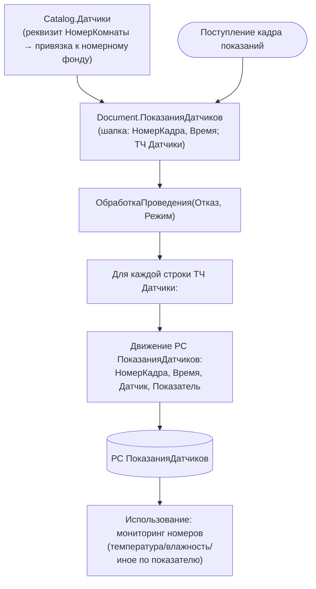

# Сценарий — Снятие показаний датчиков (доменное расширение БПО)

> Источник: `Documents/ПоказанияДатчиков/ObjectModule.bsl`, `Catalog.Датчики`,
> РС `ПоказанияДатчиков`.
> **Важно:** датчики — доменное расширение конфигурации «ОТЕЛЬ» (привязка к номеру комнаты),
> а НЕ часть типовой библиотеки БПО. Включено в модуль как смежная «телеметрия оборудования».
> 🟡 Источник заполнения ТЧ Датчики документа (опрос устройства/импорт) в ObjectModule не виден.

**Ключевые точки (🟢):**
- Проведение — прямой конструктор движений: одна запись РС на каждую строку ТЧ.
- Связь с гостиничным доменом: `Catalog.Датчики.НомерКомнаты` соотносит датчик с комнатой.

**Пробел (🔴):** механизм наполнения ТЧ `Датчики` (опрос физического устройства, внешний приём кадра)
в разобранном `ObjectModule` отсутствует — заполнение происходит вне модуля проведения (форма/обмен), не локализовано.
