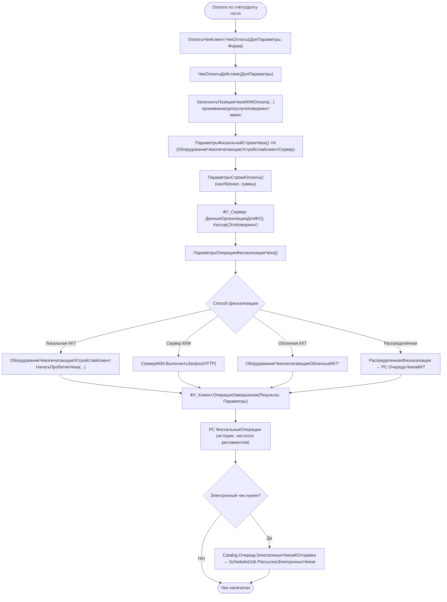

# Сценарий — Пробитие фискального чека (БПО)

> Источник: `CommonModules/ОплатыЧекКлиент/Module.bsl` (`ЧекОплаты`, `ЧекОплатыДействие`,
> `ЗаполнитьПозицииЧекаККМОплата*`, `ФУ_ПечатьТекста`), `CommonModules/ФУ_Клиент/Module.bsl`
> (`ВыполнитьОперацию`, `ОперацияЗавершение`), фасад
> `ОборудованиеЧекопечатающиеУстройстваКлиент/КлиентСервер`.
> 🟡 Низкоуровневое формирование фискального документа и связь с ФН — внутри библиотеки БПО.

**Ключевые точки (🟢):**
- Домен формирует **позиции и оплаты** (`ОплатыЧекКлиент`), библиотека — собственно фискализацию.
- Поддержка маркировки: при наличии КМ — через `МенеджерОборудованияМаркировка*` (проверка ФЛК/ИСМ).
- 4 способа фискализации сосуществуют (локальная / Сервер ККМ / облачная / распределённая через очередь).
