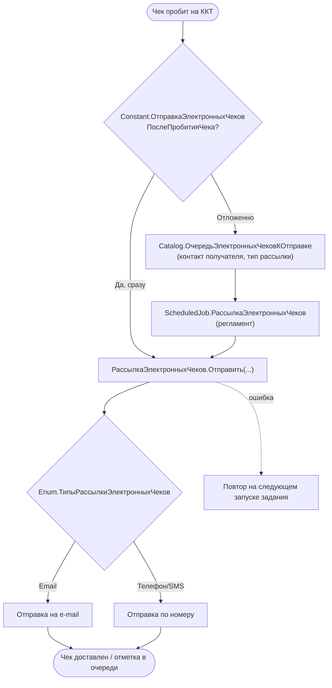

# Сценарий — Рассылка электронных чеков (БПО)

> Источник: подсистема `…/ЧекопечатающиеУстройства/РассылкаЭлектронныхЧеков`,
> `Catalog.ОчередьЭлектронныхЧековКОтправке`, `ScheduledJob.РассылкаЭлектронныхЧеков`,
> `CommonModule.РассылкаЭлектронныхЧеков*`, `Enum.ТипыРассылкиЭлектронныхЧеков`,
> `Constant.ОтправкаЭлектронныхЧековПослеПробитияЧека`.
> 🟡 Транспорт доставки (email/SMS/мессенджер) — внутри библиотеки/интеграций, вглубь не разбирался.

**Ключевые точки (🟢):**
- Очередь развязывает пробитие и доставку: `Catalog.ОчередьЭлектронныхЧековКОтправке` + регламент.
- Режим (сразу/отложенно) управляется константой `ОтправкаЭлектронныхЧековПослеПробитияЧека`.
- Смежно: домен «ОТЕЛЬ» имеет собственные каналы (WhatsApp/Telegram) — см. модуль «Интеграции и обмен».
