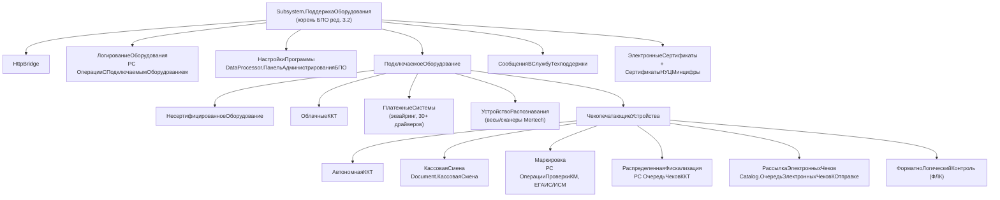
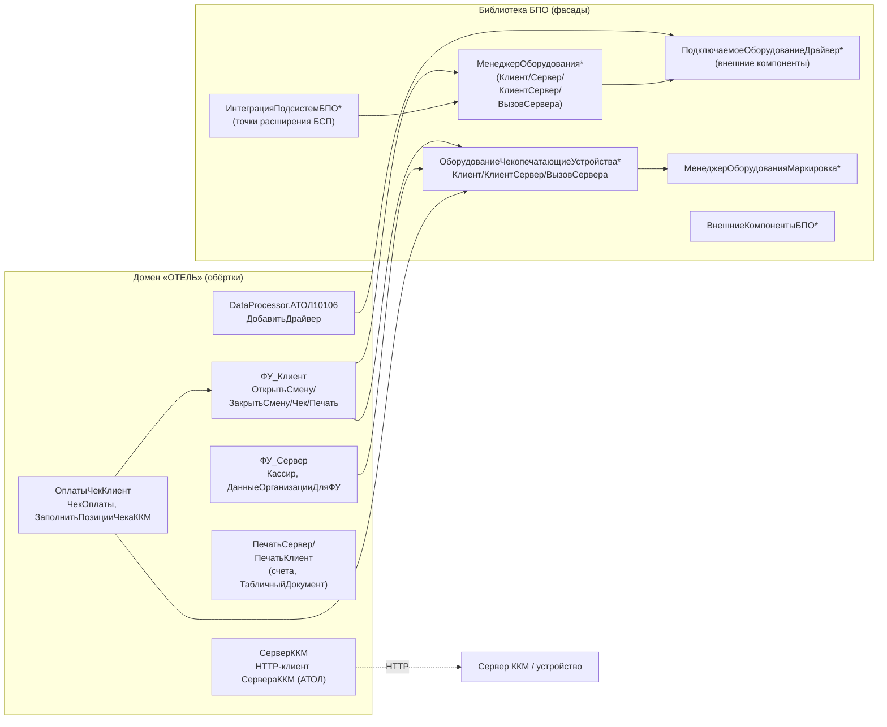
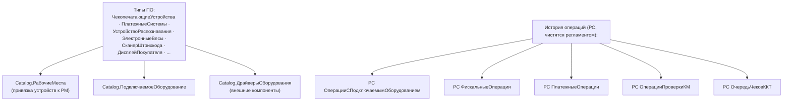

# Flowchart модуля — Подключаемое оборудование (БПО)

> Архитектурный обзор: дерево подсистемы `ПоддержкаОборудования`, фасады библиотеки БПО (ред. 3.2)
> и доменные обёртки конфигурации «ОТЕЛЬ», вызывающие библиотеку.
> Шкала доверия: 🟢 подтверждено кодом/метаданными · 🟡 выведено · 🔴 пробел.
>
> **Граница анализа:** БПО — встроенная библиотека на сотни тысяч строк. Дерево и фасады
> картированы по метаданным (`<content>` подсистем) и сигнатурам модулей; внутренности
> драйверов и протоколов устройств вглубь НЕ разбирались (🔴 — осознанная граница).

## Дерево подсистемы `ПоддержкаОборудования` (🟢 по `.mdo`)

## Слой фасадов: библиотека ↔ домен (🟢/🟡)

## Категории устройств (Enum.ТипыПодключаемогоОборудования) и записи операций (🟢)

