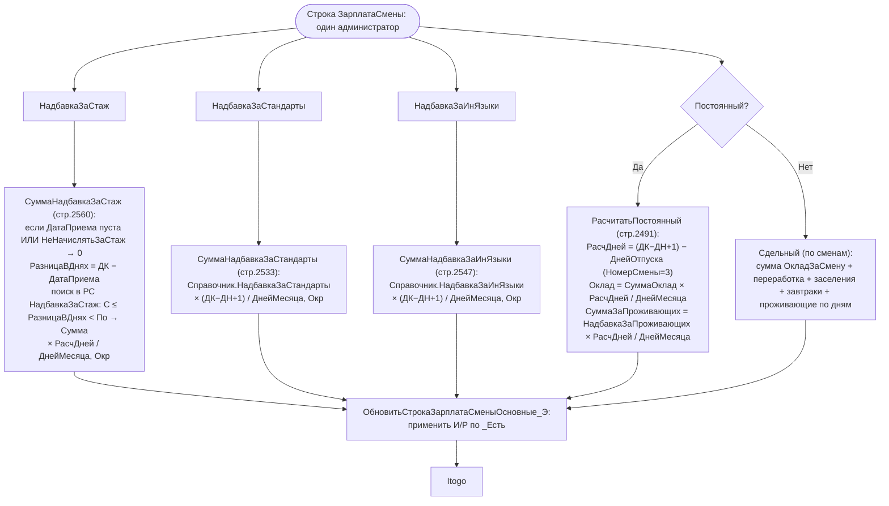
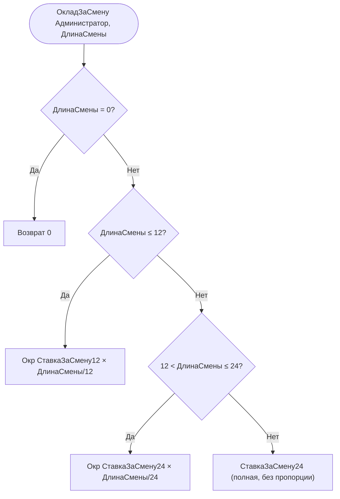
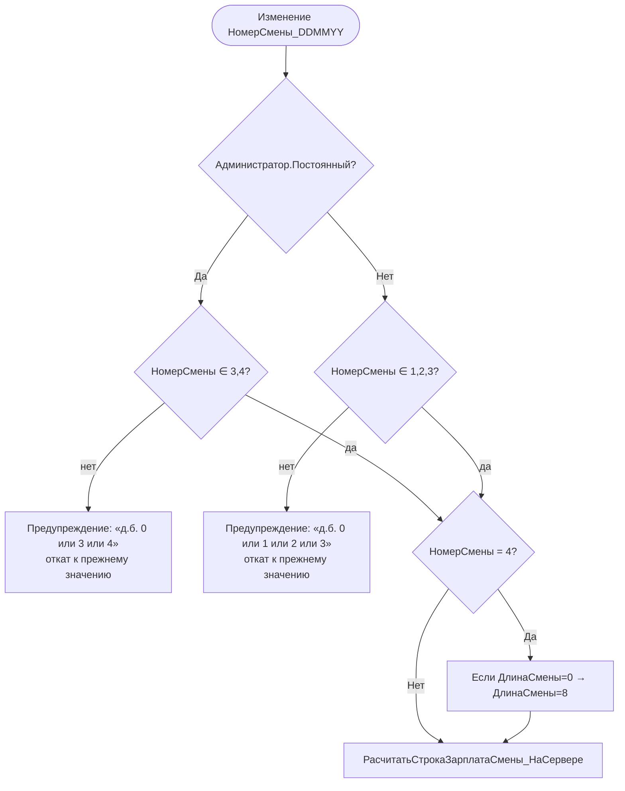
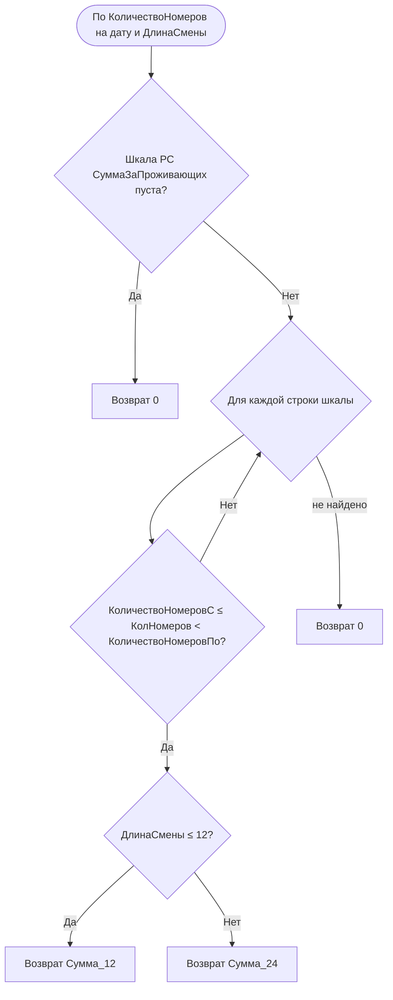

# Flowchart функции: Расчёт зарплаты администратора (детально)

> Источник: `ПСН_РЕНОМЕ__АУДИТ/src/Documents/АдминистраторыЗарплата/Forms/ФормаДокумента/Module.bsl`
> Доверие: 🟢 ПОДТВЕРЖДЕНО (формулы извлечены построчно).

## Формулы расчёта по администратору

## Оклад за смену (сдельный администратор) — `ОкладЗаСмену` (стр.2866)

## Номер смены — валидация и семантика (стр.2600 `НомерСмены_ПриИзменении`)

> Семантика номеров смен (🟡 ВЫВЕДЕНО из валидаций и `КоличествоРасчетныхДней`):
> - **0** — администратор не работал в этот день;
> - **1** — дневная смена (старт 09:00, `ManagerModule.ДатаВремяСмена`);
> - **2** — ночная смена (старт 21:00);
> - **3** — отпуск/отпускной день (исключается из расчётных дней постоянного, `КоличествоРасчетныхДней` стр.2521);
> - **4** — особая смена для постоянных (по умолчанию ДлинаСмены=8).

## Сумма за проживающих за смену — `СуммаЗаПроживающихЗаСмену` (Manager, стр.54)

