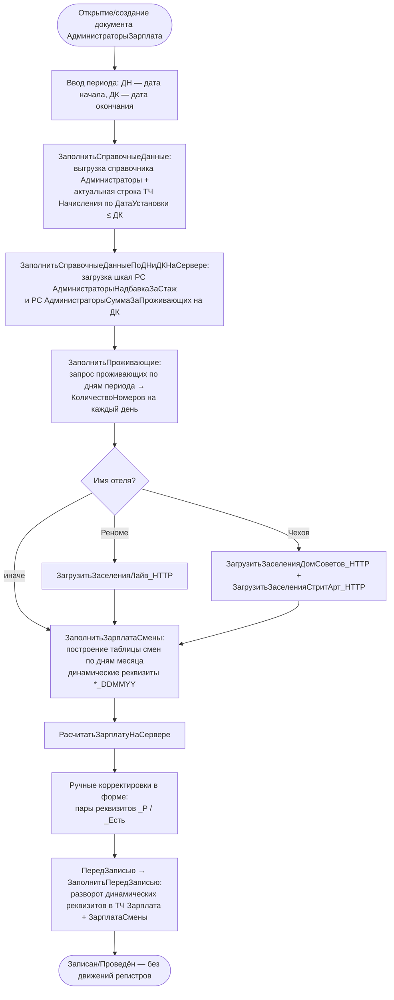
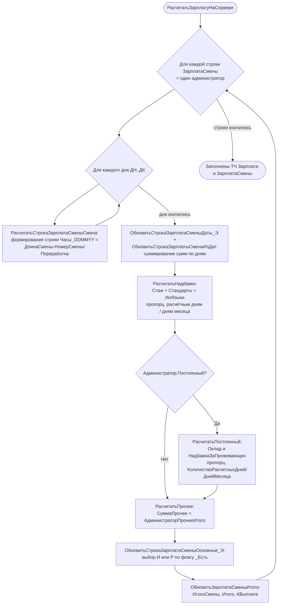
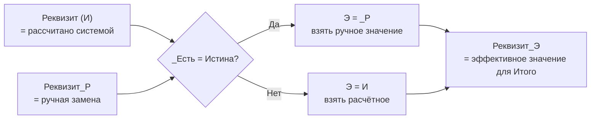
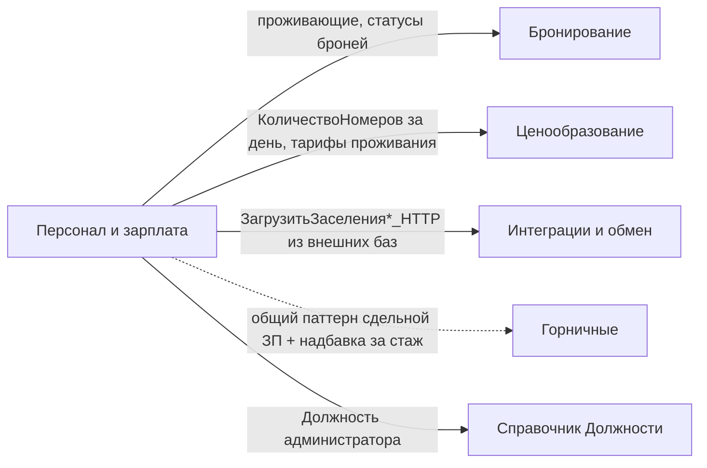

# Flowchart модуля: Персонал и зарплата

> Домен: администраторы стойки (персонал ресепшн), должности, расчёт зарплаты администраторов по сменам/окладу/надбавкам/премиям. Зарплата горничных — отдельный модуль «Горничные».
> Уровень доверия диаграммы: 🟢 ПОДТВЕРЖДЕНО (извлечено из кода `Documents/АдминистраторыЗарплата/Forms/ФормаДокумента/Module.bsl`, `ManagerModule.bsl`, `.mdo`).

## Обзор: жизненный цикл документа «Администраторы зарплата»

## Поток расчёта `РасчитатьЗарплатуНаСервере`

## Семантика троек реквизитов И / _Р / _Есть

> Примечание: для количественных «заселений/завтраков» правило иное — `_Э = И + _Р` (ручное является **дельтой**, а не заменой). См. `ОбновитьСтрокаЗарплатаСменыОсновные_Э`, строки 2055-2071.

## Связи модуля

