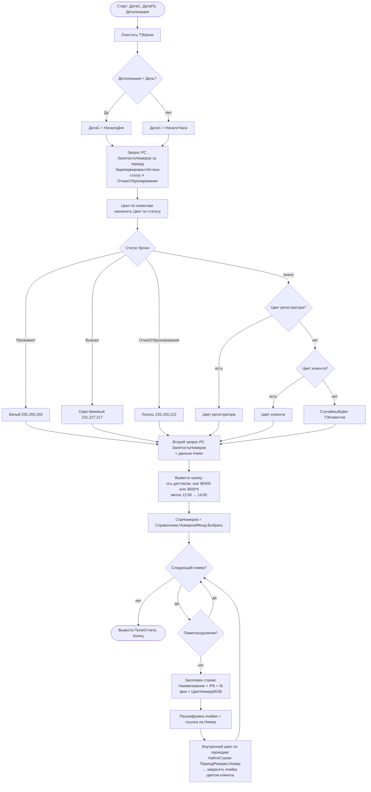

# Flowchart — `ВывестиШахматку(ДатаС, ДатаПо, Детализация)`

> `DataProcessors/Интерфейс/Forms/Форма/Module.bsl:1096-1432` 🟢
> Построение шахматки размещения (сетка «комната × время»).

## Замечания
- Шаги F и I дублируют запрос к `ЗанятостьНомеров` (отдельно цвета клиентов и данные ячеек). 🟡 возможна оптимизация.
- Внутренний цикл закраски (P, стр. 1295-1432) пересекается с логикой брони — детально принадлежит модулю «Бронирование». 🟡
