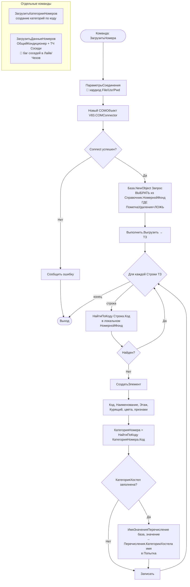
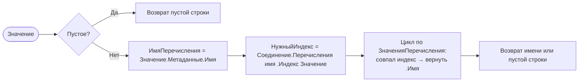

# Flowchart — Загрузка номеров из внешней базы

> `DataProcessors/ЗагрузкаНомеров{Лайв,Реноме,Чехов}/Forms/Форма/Module.bsl` 🟢
> Три обработки структурно идентичны (различаются строкой COM-подключения). Показан общий поток.

## Хелпер `ИмяЗначенияПеречисление(Соединение, Значение)`

## Замечания
- 🔴 Строки подключения с паролем захардкожены (`UsingHardcodePath`, `UsingHardcodeSecretInformation`).
- 🔴 `ЗагрузитьДанныеНомеров` в Лайв/Чехов: цикл `Для Каждого ... Из ТЗ.Соседи` (надо `Строка.Соседи`) и присваивание `НоваяСтрокаСоседиСоседнийНомер` без точки → соседи не пишутся. В Реноме исправлено.
- Создание только отсутствующих (идемпотентность по коду); существующие номера не обновляются основной командой. 🟢
