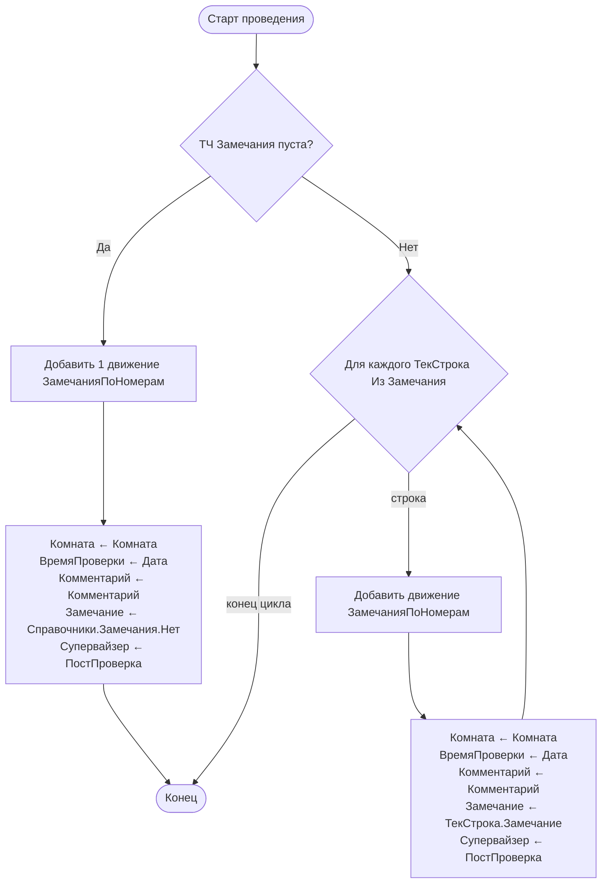

# Flowchart — `ОсмотрНомера.ОбработкаПроведения(Отказ, Режим)`

> `Documents/ОсмотрНомера/ObjectModule.bsl:2-28` 🟢
> Формирование движений РС `ЗамечанияПоНомерам`.

## Замечания
- Код сгенерирован «Конструктором движений регистров» (метка `__КОНСТРУКТОР_ДВИЖЕНИЙ_РЕГИСТРОВ`). 🟢
- `registerRecordsDeletion=AutoDelete` — при отмене проведения движения удаляются автоматически. 🟢
- Нет транзакции/обработки исключений — стандартное автопроведение платформы. 🟡
