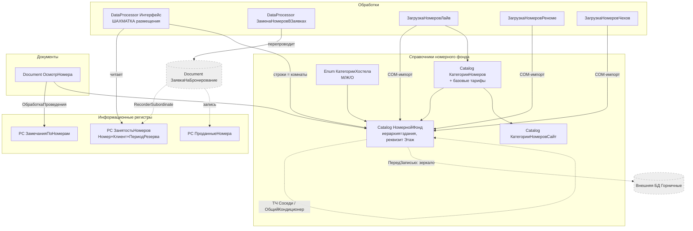

# Flowchart — Модуль «Размещение и номерной фонд»

> Модульный уровень: основные объекты номерного фонда и их связи.
> Шкала доверия: 🟢 ПОДТВЕРЖДЕНО · 🟡 ВЫВЕДЕНО · 🔴 ПРОБЕЛ.

## Граф объектов и потоков



## Границы модуля

- **Запись в `ЗанятостьНомеров`/`ПроданныеНомера`** — модуль **Бронирование** (здесь только структура и чтение шахматкой). 🟢
- **Зеркалирование во внешнюю БД горничных** и каталог `ГорничныеНомера` — модуль **Горничные**. 🟢
- **Базовые тарифы в `КатегорииНомеров`** и расчёт проживания — модуль **Ценообразование**. 🟡
- **`КатегорииНомеровСайт`** питает сопоставление при импорте брони с сайта — модуль **Интеграции**. 🟡
- **Коворкинг** (`КоворкингШахматка`, `КоворкингНомера`, `ЗанятостьНомеровКоворкинг`) — НЕ этот модуль (только признак `Коворкинг` на номере). 🟢
```
