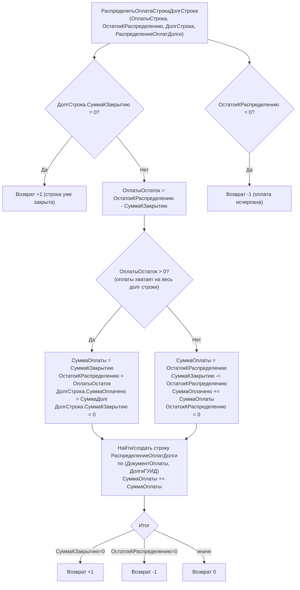
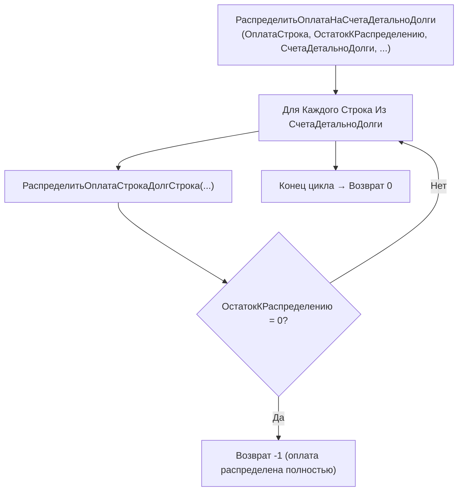
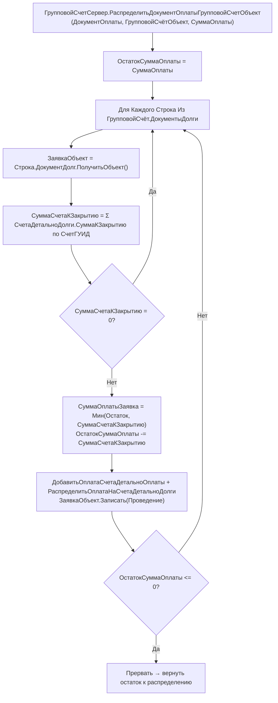

# Flowchart функции: гашение долгов (FIFO-распределение оплаты)

> `CommonModules/ЗаявкаОбщееКлиентСервер/Module.bsl:23-100` 🟢
> Ядро: `РаспределитьОплатаСтрокаДолгСтрока` → `РаспределитьОплатаНаСчетаДетальноДолги`.
> Долги хранятся не в регистре, а в ТЧ заявки `СчетаДетальноДолги`
> (СуммаДолг, СуммаКЗакрытию, СуммаОплачено) с ключами СчетГУИД / ДолгиГУИД.

## Распределение одной оплаты на одну строку долга

## Цикл по всем строкам долга (FIFO)

## Гашение долгов через групповой счёт (контрагент-плательщик)

## Ключевые правила
- Алгоритм гашения — FIFO по строкам ТЧ `СчетаДетальноДолги`: оплата идёт на строки по порядку, гася `СуммаКЗакрытию` до нуля. 🟢
- Идемпотентность по паре (ДокументОплаты, ДолгиГУИД): повторная оплата накапливается в существующую строку `РаспределениеОплатДолги`, а не дублирует её. 🟢
- Возвращаемые коды-флаги: `+1` строка/долг закрыт, `-1` оплата исчерпана, `0` продолжаем. 🟢
- `ГашениеДолгов_Старая` (`Documents/ГашениеДолгов_Старая/ObjectModule.bsl:2-16`) — устаревший контур, прямо пишет Расход в регистр `Долги` по ТЧ `Долги.СуммаПогашения`; в актуальном контуре долги ведутся в ТЧ заявки, а не в регистре. 🟡
