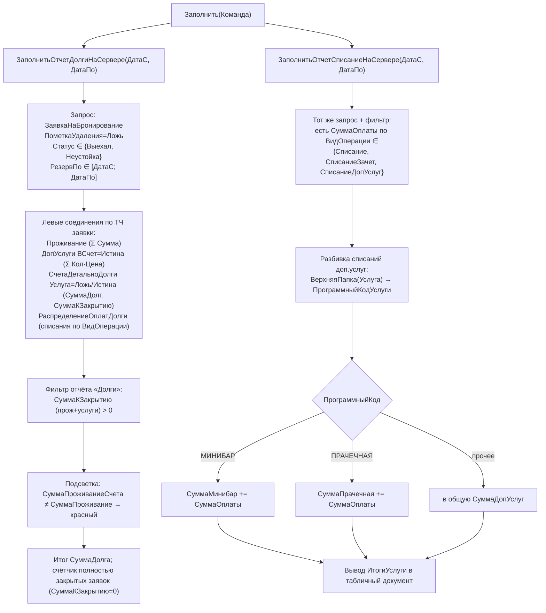

# Flowchart функции: закрытие финансового периода

> `DataProcessors/ЗакрытиеФинансовогоПериода/ManagerModule.bsl` (ЗаполнитьОтчетДолгиНаСервере) 🟢
> `DataProcessors/ЗакрытиеФинансовогоПериода/Forms/Форма/Module.bsl:18-392` 🟢
> Это отчёт-сверка (не проводящий документ): строит «Долги к закрытию» и «Списания».

## Ключевые правила
- В закрытие попадают только заявки со статусом `Выехал` или `Неустойка` с датой выезда (`РезервПо`) внутри периода. 🟢
- «Долг к закрытию» = `Σ СчетаДетальноДолги.СуммаКЗакрытию` (проживание + услуги) > 0. 🟢
- «Списание» классифицируется по `ВидыОпераций` документа `ПрочиеОплаты`: Списание / СписаниеЗачет / СписаниеДопУслуг. 🟢
- Списания доп.услуг агрегируются по `ПрограммныйКодУслуги` родительской папки услуги (МИНИБАР / ПРАЧЕЧНАЯ). 🟢
- `ЗакрытиеДокументов` — отдельная обработка: помечает заявки `Закрыто=Истина` за месяц при условии «месяц закрытия < текущий месяц». 🟢
- `ЗакрытьСмену` — фискальное закрытие смены через `ФУ_Клиент.ЗакрытьСмену` (фактическая логика в модуле БПО/фискального оборудования). 🟢
