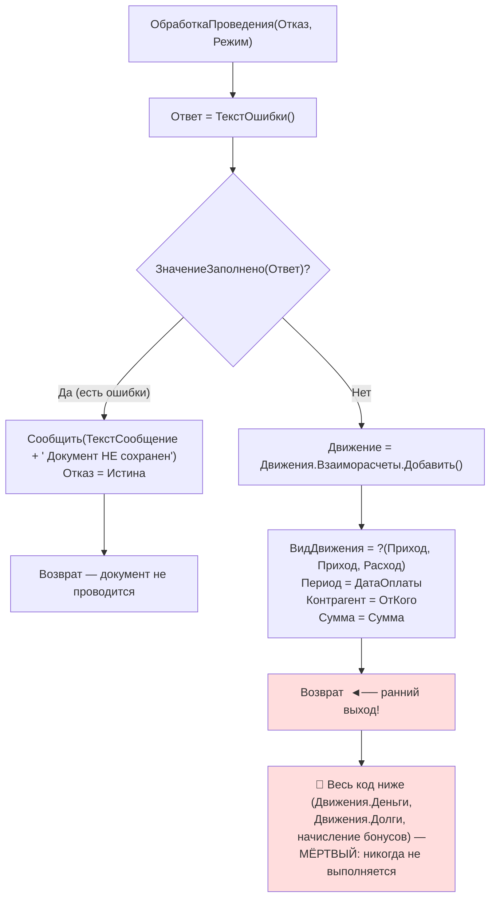
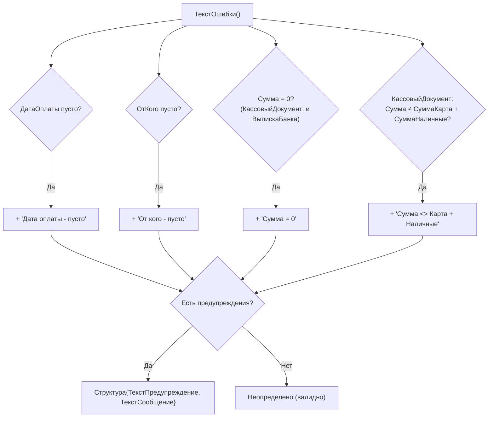

# Flowchart функции: проведение документов оплаты (КассовыйДокумент / ВыпискаБанка / ПрочиеОплаты)

> `Documents/КассовыйДокумент/ObjectModule.bsl:65-155` 🟢
> `Documents/ВыпискаБанка/ObjectModule.bsl:65-179` 🟢
> `Documents/ПрочиеОплаты/ObjectModule.bsl:65-173` 🟢
>
> Все три документа имеют идентичную структуру `ОбработкаПроведения`.

## Валидация — Функция ТекстОшибки() 🟢

## Ключевые правила
- Знак движения определяется булевым реквизитом `Приход`: Истина → ВидДвиженияНакопления.Приход, Ложь → Расход. 🟢
- Период всех движений = `ДатаОплаты` (не `Дата` документа). 🟢
- В `КассовыйДокумент` дополнительно сверяется `Сумма = СуммаКарта + СуммаНаличные` (контроль раскладки оплаты). 🟢
- Фактически проводится ТОЛЬКО регистр `Взаиморасчеты`; гашение конкретных долгов выполняется отдельно — через ТЧ заявки `РаспределениеОплатДолги` (см. Финансы-ГашениеДолгов.md). 🟢
