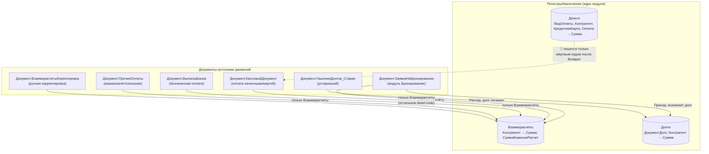
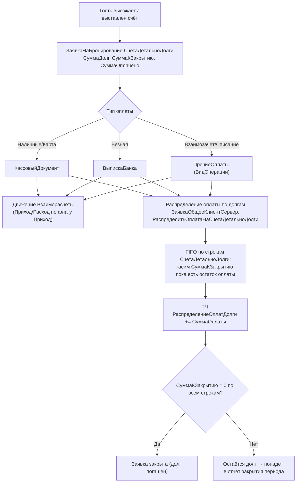
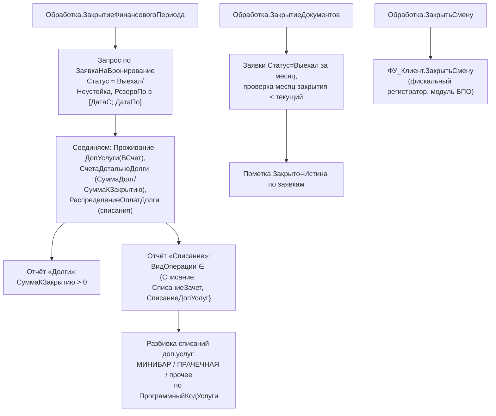

# Flowchart модуля «Финансы и касса»

> Уровень: detalhado. Шкала доверия: 🟢 подтверждено / 🟡 выведено / 🔴 пробел.
> Домен: деньги, долги, взаиморасчёты гостей/контрагентов, кассовые документы,
> банковские выписки, групповые счета, закрытие финансового периода.

## Архитектура движений (кто пишет в регистры-ядро)

## Сквозной поток оплаты долга гостя (фактический контур через ТЧ заявки)

## Закрытие финансового периода / месяца

